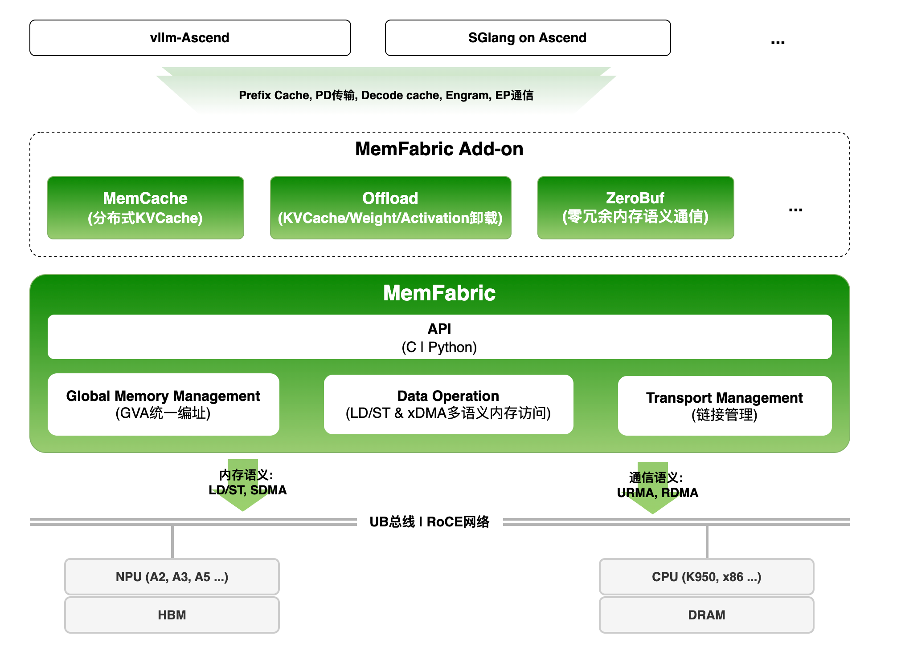
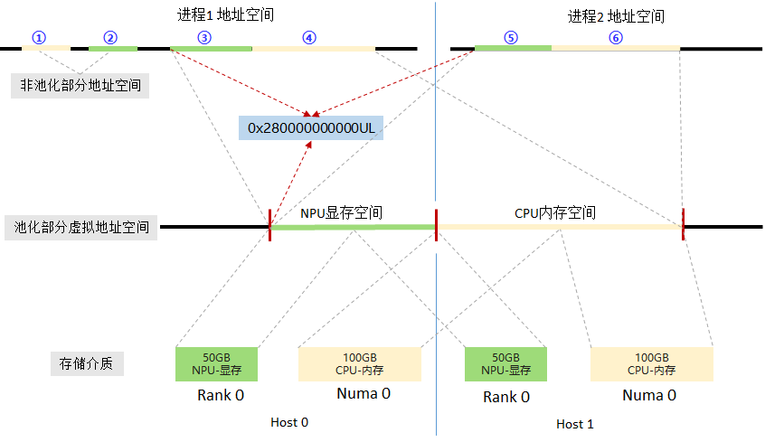
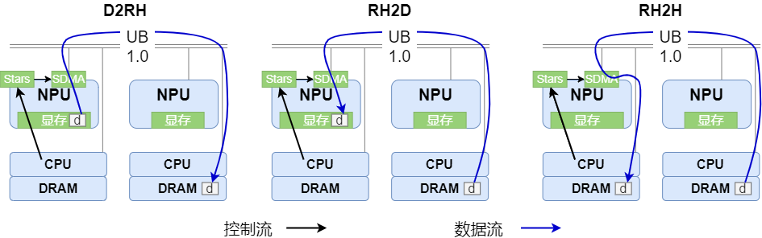
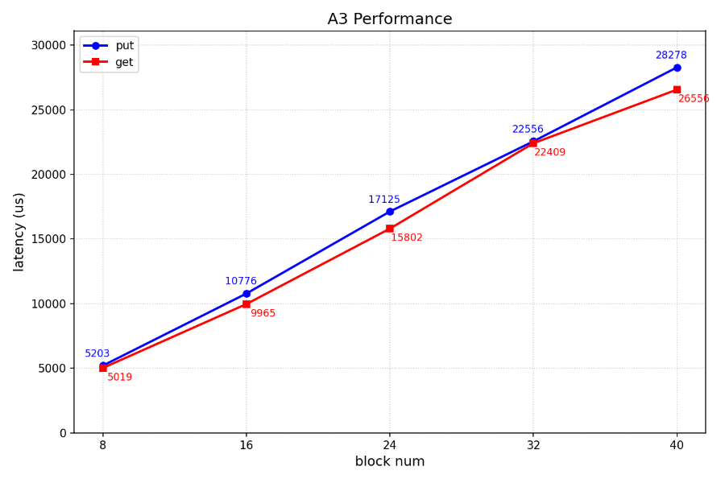
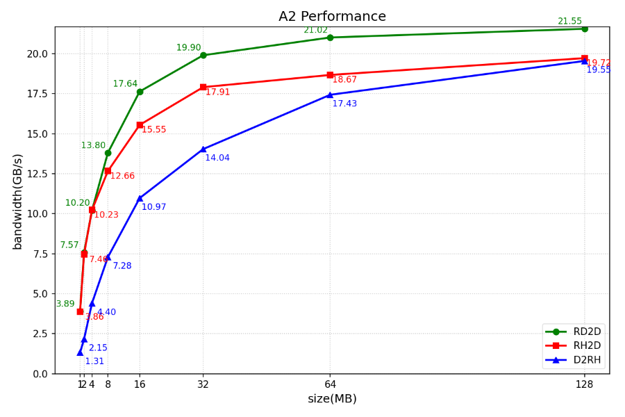

<h1 align="center" style="margin: 0;"></h1>
<div align="center">
  <hr style="display:block; border:none; height:0; border-top:2px solid #008000; width:100%; max-width:1250px; margin:20px auto;">
  <h2 align="center">
DRAM&HBM hybrid pooling, memory semantic interface, high-performance cross-machine memory direct access
  </h2>

[](https://gitcode.com/Ascend/memfabric_hybrid)
[](https://pypi.org/project/memfabric-hybrid/#history)
[](https://pypi.org/project/memfabric-hybrid/)
[](https://pypi.org/project/memfabric-hybrid/)
[](https://gitcode.com/Ascend/memfabric_hybrid/analysis)
[](./LICENSE)

</div>
<br/>

## 🔄Latest News

- [2026/09] MemFabric Offload基于GVA统一编址内存直访，加速离散小数据块从DRAM池加载到HBM，优化SGLang HiCache L2加速[PR#38826](https://github.com/sgl-project/sglang/pull/38826)

- [2026/08] MemFabric GVA统一编址支持FlowTrain分离式多模态训练框架，论文已被EMNLP 2026 Industry Track录用，在工业级VLM训练中实现超50% MFU、最高1.7倍吞吐提升，[技术解读](https://developer.jdcloud.com/article/4562)，[论文](https://arxiv.org/pdf/2606.23087)

- [2025/12] MemFabric + MemCache 已作为 vLLM-Ascend 的 KV Pool 后端使能大模型推理加速，详情请参见 vLLM-Ascend 官方文档：[使用示例](https://docs.vllm.ai/projects/ascend/en/latest/user_guide/feature_guide/kv_cache_pool_ascend_store.html#scenario-2-memcache-backend)

- [2025/11] MemFabric项目于2025年11月开源，在昇腾上提供高效的多链路的D2RH,RH2D,RH2H,D2D,D2H,H2D等内存直接访问能力。

## 🔜 Roadmap

MemFabric [**Roadmap**](https://gitcode.com/Ascend/memfabric_hybrid/wiki/Roadmap.md)
MemFabric [**版本分支策略**](https://gitcode.com/Ascend/memfabric_hybrid/wiki/%E5%88%86%E6%94%AF%E7%AD%96%E7%95%A5.md)

## 🎉概述

  MemFabric是一款开源内存池化软件，面向昇腾超节点、昇腾服务器、鲲鹏超节点、鲲鹏服务器等硬件，其设计目的与核心思想是:

  - 异构设备的统一池化: 将多节点的异构设备内存(DRAM|HBM等)池化, 基于GVA(Global Virtual Address)提供高性能的全局内存"直接访问"能力
  - 简单的北向接口: 提供内存语义访问接口, 即xcopy with GVA, 贴近传统memcpy概念，通过xcopy完成数据交换, 支持D2RH\RH2D\RH2H\D2D等多向访问
  - 南向高可扩展: 支持插件化对接多种DMA引擎(Device SDMA、Device RDMA、Device URMA、Device UBoE、Host RDMA、Host TCP、Host URMA、Host SHM等多种协议或引擎)



## 🧩核心特性

### 池化与全局统一编址

MemFabric通过构建逻辑上的全局内存语义统一编址，对分布在不同层级、不同节点的内存单元进行统一管理与使用，使系统能够像管理单一物理资源一样，对跨CPU、NPU的内存资源进行统一寻址和透明访问，核心目的是实现内存资源的整合与统一调度，最大程度的释放硬件性能。
GVA的特点:

  - 它是一个简单的uint64
  - 所有进程的GVA的起始地址一致
  - 所有进程的GVA按线性排布且一致



### 跨机跨介质直接访问

  基于MemFabric内存语义统一编址，数据可以在跨节点的多级存储间实现透明、直接访问。

  典型跨节点跨介质的访问路径有：

  - D2RH：本机HBM到跨机DRAM
  - RH2D：跨机DRAM到本机HBM
  - RH2H：跨机DRAM到本机DRAM

  Note: D为Device, RH为Remote Host

MemFabric跨机访问数据流和控制流如下图所示(昇腾A3超节点):



## 🔥性能表现

### 时延测试

- 使用2个昇腾A3节点组成双机内存池进行读写时延测试，模拟构造DeepSeek-R1模型KV大小的block size，即：61x128K + 61x16K = 8784KB ≈ 8.57MB，共122个离散地址，性能表现如下:



### 带宽测试(单DIE+单CPU)

- 在昇腾A3超节点跨机数据访问性能(DRAM and HBM pooling over UB 1.0)如下：

| 数据传输方向 | 单次数据大小（GB） | 带宽（GB/s）|
|--------| -----------------| --------- |
| RH2D   | 1 | 110.23 |
| RH2D   | 2 | 110.19 |
| D2RH   | 1 | 74.54 |
| D2RH   | 2 | 74.54 |
| RD2D   | 1 | 166.47 |
| RD2D   | 2 | 166.47 |
| D2RD   | 1 | 138.01 |
| D2RD   | 2 | 138.01 |

> [!NOTE] 说明
> 和昇腾官方带宽测试工具[ascend-dmi](https://www.hiascend.com/document/detail/zh/mindcluster/latest/toolbox/toolboxug/toolboxug_0013.html)一样，A3超节点测试采用的通信带宽的统计方式，`1 GB/s = 1000 * 1000 * 1000 B/s`。

- 在昇腾A2服务器跨机数据访问性能(DRAM and HBM pooling over Device RoCE)如下:



 👆 性能测试参考 [benchmark](./benchmark/bm/README.md)

## 🔍目录结构

```text
├── LICENSE                    # 许可证
├── CMakeLists.txt             # CMake构建入口
├── app                        # 基于MemFabric的官方应用
│  ├── tensorRTL               # 高性能Tensor Reshard组件
│  └── zbal                    # Zero Buffer Acceleration Library
├── docs                       # 文档
├── examples                   # 样例
│  ├── hbm_share_memory        # HBM共享内存样例(AllReduce/ShiftPutGet/RDMADemo)
│  ├── kv_offload              # KV Offload样例
│  ├── memory_pool             # 内存池化样例（含基础/扩展/优化/特性/可观测性）
│  └── transfer                # 传输样例（含batch data write/read）
├── script                     # 构建和测试脚本
│  ├── build_and_pack_run.sh   # 编译+打包脚本
│  ├── build.sh                # 底层编译脚本
│  └── run_ut.sh               # 编译+运行UT脚本
├── test                       # 测试
│  ├── 3rdparty                # 测试依赖
│  ├── certs                   # 证书生成脚本
│  ├── python                  # Python测试用例
│  └── ut                      # 单元测试用例
├── src                        # 源码
│  ├── acc_links               # 基于Host TCP的进程间控制通信
│  ├── acc_offload             # KV Offload与卡侧稀疏拷贝加速
│  ├── hybm                    # 内存管理与内存访问层 (Global Memory Management、Data Operation、Transport Management)
│  ├── smem                    # 语义与接口层 (big memory + transfer + offload + share memory等语义与接口实现)
│  └── util                    # 公共函数
└── README.md
```

## 🚀快速入门

请访问以下文档获取简易教程。

- [编译安装](./docs/zh/installation.md): 介绍组件编译和安装教程。

- [mfcli命令行工具](./docs/zh/mfcli.md): 介绍版本查询、算子管理、内存扫描和性能测试命令。

- [DevContainer 快速入门](./docs/zh/devcontainer_quickstart.md): VS Code Remote + DevContainer 一键环境搭建 + 全量用例运行指南。

- [样例执行](./examples/memory_pool/README.md): 介绍如何端到端执行样例代码，包括C++和Python样例。

## 📑学习教程

- [API介绍](./docs/zh/feature.md)：MemFabric提供的多种API的简介

- [C接口](./docs/zh/API.md)：C接口介绍以及C接口对应的API列表

- [python接口](./docs/zh/pythonAPI.md)：python接口介绍以及python接口对应的API列表

- [ptracer](./docs/zh/ptracer.md)：MemFabric内置性能打点工具简介

## 📌FAQ

常见问题请参考：[FAQ](https://gitcode.com/Ascend/memfabric_hybrid/wiki/FAQ.md)

## 📝相关信息

- [贡献指南](./CONTRIBUTING.md)

- [社区行为准则](./CODE_OF_CONDUCT.md)

- [安全声明](./docs/zh/SECURITYNOTE.md)

- [许可证](./LICENSE)

## 说明

此开源项目非华为产品，仅提供有限支持。
