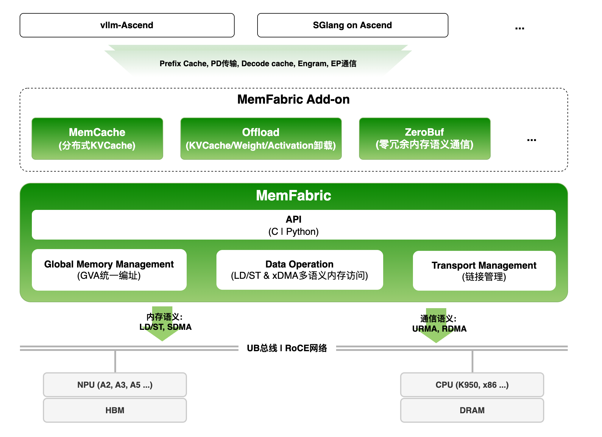
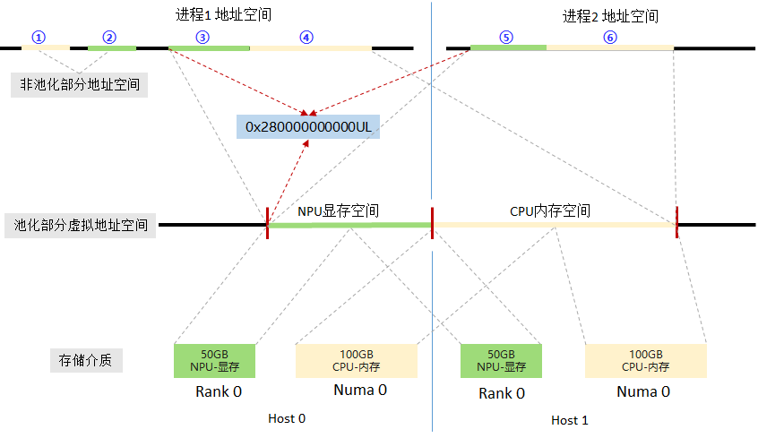
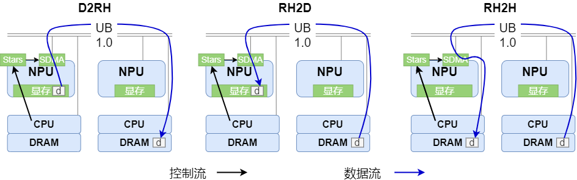
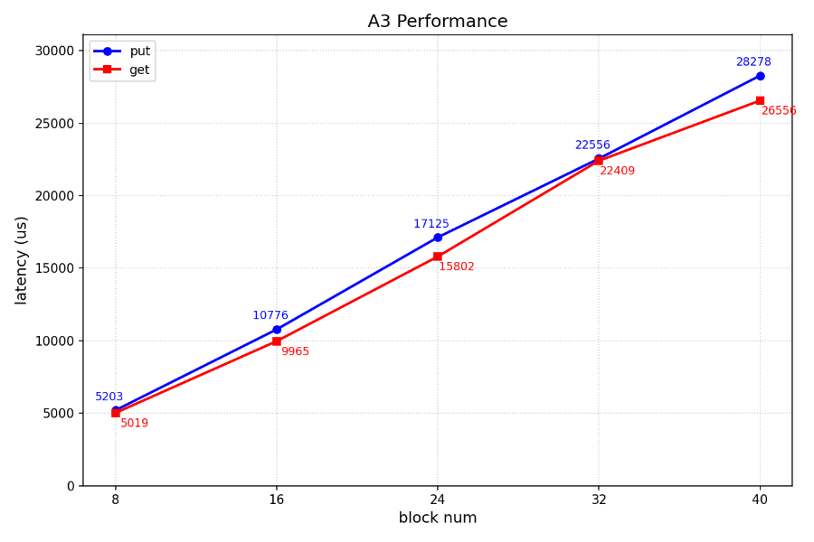
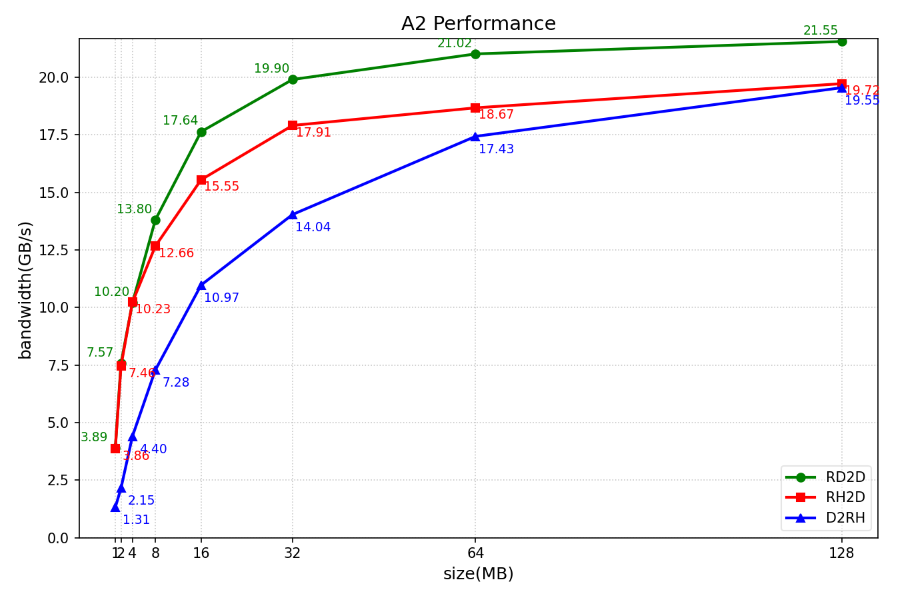

<h1 align="center"></h1>
<div align="center">
  <p><strong>
    DRAM & HBM hybrid pooling, memory semantic interfaces, high-performance cross-machine memory direct access
  </strong></p>
  <a href="https://memfabric-hybrid.readthedocs.io/zh-cn/latest/"><strong>在线文档</strong></a>
  | <a href="https://memfabric-hybrid.readthedocs.io/zh-cn/latest/wiki/quick_start/installation/">
    <strong>编译安装</strong></a>
  | <a href="https://memfabric-hybrid.readthedocs.io/zh-cn/latest/wiki/quick_start/memory_pool_quickstart/">
    <strong>快速开始</strong></a>
  | <a href="https://memfabric-hybrid.readthedocs.io/zh-cn/latest/wiki/community/Roadmap/">
    <strong>Roadmap</strong></a>
  | <a href="https://memfabric-hybrid.readthedocs.io/zh-cn/latest/wiki/developer_guide/workflow/分支策略/">
    <strong>版本分支策略</strong></a>
  <br />
  <br />

[][online-docs]
[][pypi]
[][pypi]
[][commit-activity]
[][license]

</div>

MemFabric是一款开源内存池化软件，提供跨节点DRAM与HBM统一池化、内存语义接口和高性能的全局内存直接访问能力。

## 🔄 最新动态

- **2026/10**：Mooncake TENT 已合入 MemFabric Transport 后端，可通过 MemFabric 在昇腾 NPU 上进行数据传输。
  详见[使用指南][mooncake-guide]和[合入PR][mooncake-pr]。
- **2026/09**：MemFabric Offload基于GVA统一编址内存直访，加速离散小数据块从DRAM池加载到HBM，优化SGLang HiCache L2加速。
  详见[使用指南][sglang-guide]和[合入PR][sglang-pr]。
- **2026/08**：MemFabric GVA统一编址支持FlowTrain分离式多模态训练框架，论文已被EMNLP 2026 Industry Track录用，
  在工业级VLM训练中实现超50% MFU、最高1.7倍吞吐提升。
  详见[技术解读][flowtrain-blog]和[论文][flowtrain-paper]。
- **2025/12**：MemFabric + MemCache 已作为 vLLM-Ascend 的 KV Pool 后端使能大模型推理加速，
  详情请参见 vLLM-Ascend 官方文档：[使用指南][vllm-ascend-kv-pool]和[合入PR][vllm-ascend-pr]。
- **2025/11**：MemFabric项目于2025年11月开源，在昇腾上提供高效的多链路的D2RH,RH2D,RH2H,D2D,D2H,H2D等内存直接访问能力。

## 🎉 概述

MemFabric是一款开源内存池化软件，面向昇腾超节点、昇腾服务器、鲲鹏超节点、鲲鹏服务器等硬件，
其设计目的与核心思想是：

- **异构设备的统一池化**：将多节点的异构设备内存（DRAM、HBM等）池化，
  基于GVA（Global Virtual Address）提供高性能的全局内存“直接访问”能力。
- **简单的北向接口**：提供内存语义访问接口，即`xcopy with GVA`，贴近传统`memcpy`概念，
  通过xcopy完成数据交换，支持D2RH、RH2D、RH2H、D2D等多向访问。
- **南向高可扩展**：支持插件化对接多种DMA引擎，
  包括Device SDMA、Device RDMA、Device URMA、Host RDMA、Host TCP、Host URMA、Host SHM等协议或引擎。



MemFabric提供Big Memory（BM）、Transfer（TRANS）和Acc Offload等接口，分别面向大内存池化、
跨机数据传输和KV Cache卸载。接口介绍参见[特性简介][features]。

## 🔥 能力展示

### Big Memory（BM）

BM将多节点的DRAM与HBM组织为全局内存池，通过GVA统一寻址，支持本地内存与全局内存之间的数据复制。
应用可通过C或Python接口创建内存池、获取地址并访问池内数据。详见[内存池快速开始][bm-quickstart]。

<details>
<summary>核心特性与访问路径</summary>

- **全局统一编址**：使用64位GVA表示池内地址，为各进程提供一致的全局内存视图。
- **跨机跨介质访问**：支持在本机HBM、本机DRAM和远端内存之间搬移数据。
- **动态成员管理**：支持进程动态加入与退出内存池。
- **多语言接口**：提供[C接口][bm-c-api]和[Python接口][bm-python-api]。



典型的跨节点访问路径如下，其中D表示Device，H表示Host，R表示远端。

| 方向 | 数据路径 |
| --- | --- |
| D2RH | 本机HBM到远端DRAM |
| RH2D | 远端DRAM到本机HBM |
| RH2H | 远端DRAM到本机DRAM |

昇腾A3超节点上的数据流与控制流如下。



</details>

<details>
<summary>性能表现</summary>

#### 时延测试

- 使用2个昇腾A3节点组成双机内存池进行读写时延测试，模拟构造DeepSeek-R1模型KV大小的block size，即：
  61x128K + 61x16K = 8784KB ≈ 8.57MB，共122个离散地址，性能表现如下:



#### 带宽测试(单DIE+单CPU)

- 在昇腾A3超节点跨机数据访问性能(DRAM and HBM pooling over UB 1.0)如下：

| 数据传输方向 | 单次数据大小（GB） | 带宽（GB/s）|
|--------| -----------------| --------- |
| RH2D   | 1 | 110.23 |
| RH2D   | 2 | 110.19 |
| D2RH   | 1 | 74.54 |
| D2RH   | 2 | 74.54 |
| RD2D   | 1 | 166.47 |
| RD2D   | 2 | 166.47 |
| D2RD   | 1 | 138.01 |
| D2RD   | 2 | 138.01 |

> [!NOTE] 说明
> 和昇腾官方带宽测试工具[ascend-dmi][ascend-dmi]一样，A3超节点测试采用的通信带宽的统计方式，
> `1 GB/s = 1000 * 1000 * 1000 B/s`。

- 在昇腾A2服务器跨机数据访问性能(DRAM and HBM pooling over Device RoCE)如下:



 👆 性能测试参考 [benchmark][benchmark-reference]

</details>

### Transfer（TRANS）

Transfer面向跨节点数据传输场景，应用注册已有内存后，可通过读写接口完成数据搬移，
支持大模型推理中的KV Cache传输。详见[Transfer使用简介][trans-guide]。

<details>
<summary>核心特性</summary>

- **内存注册**：对应用已有内存进行注册与注销，支持跨节点访问。
- **读写语义**：提供单次与批量读写接口。
- **异步批量传输**：支持异步提交批量传输任务，并查询执行结果。
- **多语言接口**：提供[C接口][trans-c-api]和[Python接口][trans-python-api]。

</details>

### Acc Offload

Acc Offload面向KV Cache卸载等场景，提供DRAM内存池与卡侧批量稀疏拷贝能力，
用于搬移DRAM与HBM之间的离散数据块。使用流程与本地、共享内存池配置参见[Acc Offload使用简介][offload-guide]。

<details>
<summary>核心特性</summary>

- **本地内存池**：LOCAL场景下，每个rank独占一份本地DRAM池。
- **共享内存池**：SHARED场景下，多个rank共享同一份DRAM池。
- **批量稀疏拷贝**：通过卡侧算子处理多个不连续地址之间的数据搬移。
- **PyTorch封装**：提供面向PyTorch张量的内存分配与稀疏拷贝能力。
- **多语言接口**：提供[C接口][offload-c-api]和[Python接口][offload-python-api]。

</details>

## 🌐 生态集成

MemFabric已用于数据传输、KV Cache池化和分离式训练场景，以下入口提供对应的集成说明。

| 项目 | 集成场景 | 文档或实现 |
| --- | --- | --- |
| Mooncake TENT | 通过MemFabric Transport在昇腾NPU上进行数据传输 | [使用指南][mooncake-guide]、[合入PR][mooncake-pr] |
| SGLang HiCache | L2 KV Cache搬移与基于MemCache的L3缓存池化 | [使用指南][sglang-guide]、[合入PR][sglang-pr] |
| vLLM-Ascend + MemCache | 通过MemCache后端提供KV Pool | [使用指南][vllm-ascend-kv-pool]、[合入PR][vllm-ascend-pr] |
| FlowTrain | 多模态训练中编码器与主干网络之间的数据交换 | [技术解读][flowtrain-blog]、[论文][flowtrain-paper] |

各集成的版本、环境与部署要求请参见对应文档。

## 🖥️ 硬件支持

MemFabric支持昇腾A2、A3和A5系列硬件，主要数据通路如下。
具体机型的协议支持、访问范围及底软要求参见[硬件支持文档][hardware-support]。

| 硬件系列 | 代表机型 | 主要数据通路 |
| --- | --- | --- |
| 昇腾A2 | Atlas 200T A2 Box16、Atlas 800T/800I A2 | Device RDMA |
| 昇腾A3 | Atlas 900/800T/800I A3 SuperPoD、Atlas 800I A3 Server | Device SDMA、Device RDMA |
| 昇腾A5 | Atlas 350、Atlas 850(E)、Atlas 650(E)、Atlas 950 SuperPoD等 | 依机型支持Host RDMA、Device URMA或Device RDMA |

此外，MemFabric支持无卡环境下的DRAM池化，构建与协议配置参见[编译安装][installation]和
[环境变量][environment-variables]。

## 🚀 快速开始

使用Python接口时，可通过pip安装MemFabric Hybrid：

```bash
pip install memfabric-hybrid
```

使用C接口、源码构建、离线安装、无卡部署等场景，以及NPU环境与算子配套要求，详见[编译安装][installation]。

安装完成后，可按以下入口使用组件：

- [BM使用简介][bm-guide]：了解内存池创建、全局编址与数据复制流程。
- [Transfer使用简介][trans-guide]：了解内存注册与跨节点读写流程。
- [Acc Offload使用简介][offload-guide]：配置本地或共享DRAM池并执行稀疏拷贝。
- [DevContainer快速入门][devcontainer]：搭建开发与测试环境。

## 📦 工具与文档

- [mfcli命令行工具][mfcli]：查询版本、管理算子、扫描内存并执行性能测试。
- [mfcli benchmark][benchmark-guide]：了解数据读写性能测试入口。
- [ptracer性能打点工具][ptracer]：查看MemFabric内置的性能打点能力。
- [API接口列表][api-index]：查阅BM、TRANS和Acc Offload的C与Python接口。
- [环境变量][environment-variables]：查阅运行时配置项。

## 📝 社区与相关信息

- [Roadmap][roadmap]：了解项目演进方向。
- [版本分支策略][branch-policy]：选择适合的发布与开发分支。
- [FAQ][faq]：查阅常见问题与排查方法。
- [贡献指南][contributing]：了解贡献流程。
- [社区行为准则][code-of-conduct]：了解社区协作要求。
- [安全声明][security]：了解安全配置与使用要求。
- [许可证][license]：MemFabric采用Mulan PSL v2许可证。

## 说明

此开源项目非华为产品，仅提供有限支持。

[online-docs]: https://memfabric-hybrid.readthedocs.io/zh-cn/latest/
[pypi]: https://pypi.org/project/memfabric-hybrid/
[commit-activity]: https://gitcode.com/Ascend/memfabric_hybrid/analysis
[mooncake-pr]: https://github.com/kvcache-ai/Mooncake/pull/4682
[mooncake-guide]:
  https://memfabric-hybrid.readthedocs.io/zh-cn/latest/wiki/user_guide/integration/Mooncake-MemFabric-Guide/
[sglang-pr]: https://github.com/sgl-project/sglang/pull/38826
[sglang-guide]:
  https://github.com/sgl-project/sglang/blob/main/python/sglang/srt/mem_cache/storage/npu_memcache/README.md
[vllm-ascend-kv-pool]:
  https://docs.vllm.ai/projects/ascend/en/latest/user_guide/feature_guide/kv_cache_pool_ascend_store.html#scenario-2-memcache-backend
[vllm-ascend-pr]: https://github.com/vllm-project/vllm-ascend/pull/4438
[flowtrain-blog]: https://developer.jdcloud.com/article/4562
[flowtrain-paper]: https://aclanthology.org/2026.emnlp-industry.101/
[features]: https://memfabric-hybrid.readthedocs.io/zh-cn/latest/wiki/quick_start/feature/
[bm-guide]: https://memfabric-hybrid.readthedocs.io/zh-cn/latest/wiki/quick_start/feature/#1-big-memorybm
[bm-quickstart]: https://memfabric-hybrid.readthedocs.io/zh-cn/latest/wiki/quick_start/memory_pool_quickstart/
[bm-c-api]: https://memfabric-hybrid.readthedocs.io/zh-cn/latest/wiki/user_guide/api/bm_c_api/
[bm-python-api]: https://memfabric-hybrid.readthedocs.io/zh-cn/latest/wiki/user_guide/api/bm_python_api/
[trans-c-api]: https://memfabric-hybrid.readthedocs.io/zh-cn/latest/wiki/user_guide/api/smem_trans_c_api/
[trans-python-api]: https://memfabric-hybrid.readthedocs.io/zh-cn/latest/wiki/user_guide/api/smem_trans_python_api/
[offload-c-api]: https://memfabric-hybrid.readthedocs.io/zh-cn/latest/wiki/user_guide/api/acc_offload_c_api/
[offload-python-api]: https://memfabric-hybrid.readthedocs.io/zh-cn/latest/wiki/user_guide/api/acc_offload_python_api/
[hardware-support]:
  https://memfabric-hybrid.readthedocs.io/zh-cn/latest/wiki/user_guide/basic_configuration/hardware_support/
[installation]: https://memfabric-hybrid.readthedocs.io/zh-cn/latest/wiki/quick_start/installation/
[devcontainer]:
  https://memfabric-hybrid.rtfd.io/zh-cn/latest/wiki/developer_guide/development_environment/devcontainer_quickstart/
[mfcli]: https://memfabric-hybrid.readthedocs.io/zh-cn/latest/wiki/user_guide/basic_configuration/mfcli/
[ptracer]: https://memfabric-hybrid.readthedocs.io/zh-cn/latest/wiki/developer_guide/debugging/ptracer/
[api-index]: https://memfabric-hybrid.readthedocs.io/zh-cn/latest/wiki/user_guide/api/
[environment-variables]:
  https://memfabric-hybrid.readthedocs.io/zh-cn/latest/wiki/user_guide/basic_configuration/environment_variables/
[branch-policy]: https://memfabric-hybrid.readthedocs.io/zh-cn/latest/wiki/developer_guide/workflow/分支策略/
[roadmap]: https://memfabric-hybrid.readthedocs.io/zh-cn/latest/wiki/community/Roadmap/
[faq]: https://memfabric-hybrid.readthedocs.io/zh-cn/latest/wiki/FAQ/FAQ/
[contributing]: https://memfabric-hybrid.readthedocs.io/zh-cn/latest/wiki/developer_guide/contributing/
[code-of-conduct]: https://memfabric-hybrid.readthedocs.io/zh-cn/latest/wiki/developer_guide/code_of_conduct/
[security]: https://memfabric-hybrid.readthedocs.io/zh-cn/latest/wiki/user_guide/security/SECURITYNOTE/
[trans-guide]: https://memfabric-hybrid.readthedocs.io/zh-cn/latest/wiki/quick_start/feature/#2-transfertrans
[offload-guide]: https://memfabric-hybrid.readthedocs.io/zh-cn/latest/wiki/quick_start/feature/#3-acc-offload
[benchmark-guide]:
  https://memfabric-hybrid.readthedocs.io/zh-cn/latest/wiki/user_guide/basic_configuration/mfcli/#运行-benchmark
[license]: https://license.coscl.org.cn/MulanPSL2
[ascend-dmi]: https://www.hiascend.com/document/detail/zh/mindcluster/latest/toolbox/toolboxug/toolboxug_0013.html
[benchmark-reference]:
  https://gitcode.com/Ascend/memfabric_hybrid/tree/master/src/smem/python/memfabric_hybrid/memfabric_hybrid/benchmark
