# MemFabric 管理面流程整改：新旧方案对比

## 0. 整改范围总览

| 维度            | 旧方案                           | 新方案                                          |
| --------------- | -------------------------------- | ----------------------------------------------- |
| 组管理引擎      | SmemNetGroupEngine (CAS+Barrier) | SmemGroupManager (async server-driven)          |
| 节点加入        | 同步 Barrier + GatherResult      | 异步 promise/future + 回调                      |
| 节点退出        | GroupLeave + 同步通知            | server 驱动 leave notify                        |
| 内存扩展        | GroupUpdate (CAS retry)          | ExtendMemory 状态机 (state-driven)              |
| 拓扑协调        | 每个 rank 独立 CAS               | AccStoreServer 统一决策                         |
| 维测接口        | 无暴露（内部状态不可见）         | smem_bm_get_store_server_info + leader callback |
| Server 状态查询 | 无                               | SmemGroupCommandAsyncDispatcher 事件队列可查    |
| 外部 API 兼容   | SmemNetGroupEngine 依赖性        | deprecated stub + 新 API                        |

---

## AS-IS / TO-BE 概览

### AS-IS：多节点争抢 Join 模式（去中心化）

旧方案中，每个 rank 启动后独立在 ConfigStore 上通过 CAS 操作竞争加入集群，多个 rank 之间没有协调者，完全靠 CAS 原语保证一致性：

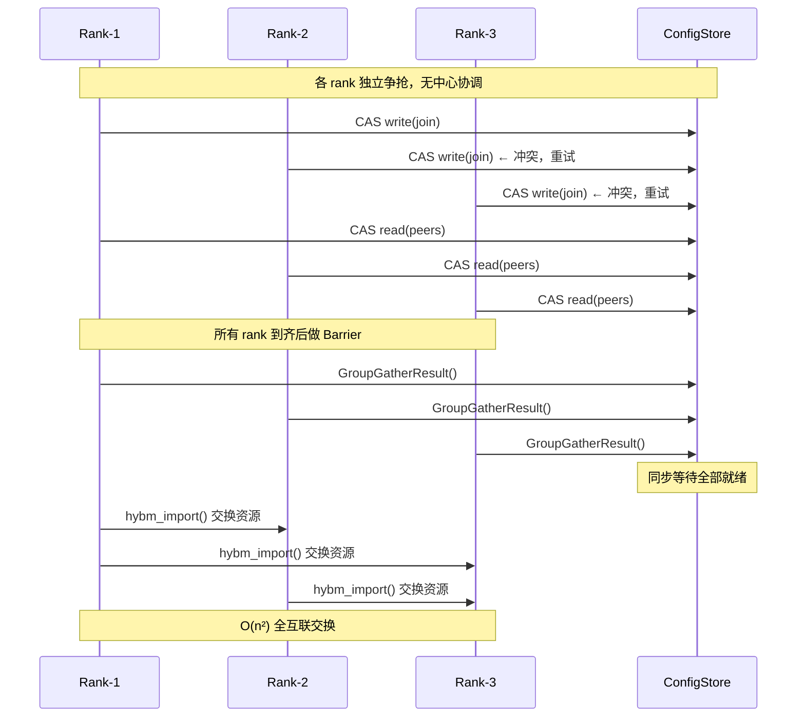

**特征：**

- 每个 rank 在 ConfigStore 上通过 CAS 自旋写入自己的信息，同时读取 peer 信息
- 所有 rank 到齐后通过 `GroupGatherResult` 做同步 Barrier，全部就绪才能继续
- `hybm_import` 需要在所有 rank 之间两两交换资源，通信量 O(n²)
- CAS 冲突率随集群规模增长，大规模集群下 retry 频繁

### TO-BE：中心化有序调度模式

新方案中，AccStoreServer（leader）作为唯一的决策者，所有 rank 的加入/离开由 server 统一调度：

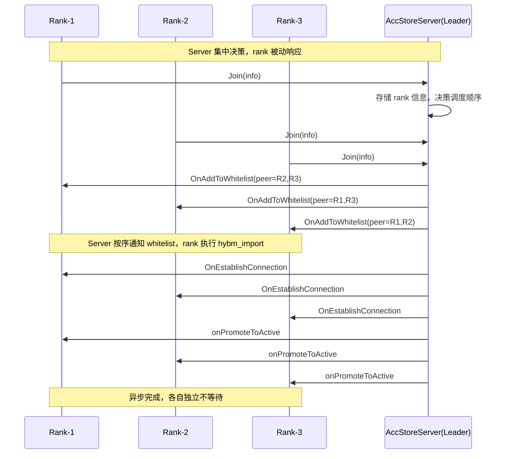

**特征：**

- **AccStoreServer（leader）作为唯一决策者**，所有 join/leave 请求都发给它
- server 按序处理每个事件，通过 `SmemGroupCommandAsyncDispatcher` 分发到事件队列
- rank 只注册回调，被动响应 server 的 whitelist/connect/promote 通知
- join 从同步 Barrier 变为异步回调，各 rank 独立完成，不互相等待
- 后续管理面事件（leave、extend memory）同样走 server 统一调度，不会出现竞争

### 核心差异

| 维度     | AS-IS：多节点争抢         | TO-BE：中心化调度          |
| -------- | ------------------------- | -------------------------- |
| 决策者   | 无，各 rank 独立 CAS 竞争 | AccStoreServer（leader）   |
| 协调方式 | CAS + Barrier（同步）     | 事件队列 + 异步回调        |
| 资源交换 | 全互联 O(n²)              | server 按序通知 O(n)       |
| 冲突处理 | CAS retry（可能多次重试） | 不存在冲突（单点决策）     |
| 扩展性   | 集群越大 CAS 冲突越高     | 规模不影响决策效率         |
| 可观测性 | 无中间状态                | 事件队列可查，每阶段有日志 |

---

## 1. 节点加入/离开流程

### 1.1 旧方案：SmemNetGroupEngine + CAS Barrier

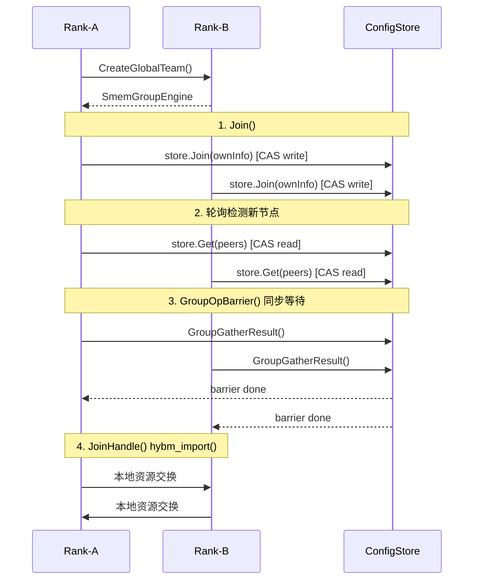

**关键问题：**

- **Join 是同步 Barrier**：GroupGatherResult 阻塞所有后续操作直到所有 rank 都就绪
- **CAS 自旋**：ConfigStore 上 CAS 写入/读取，高并发下冲突频繁
- **Update/Leave 同样 Barrier**：GroupUpdate/GroupLeave 也需要 barrier
- **GFB 空转**：CreateGlobalTeam 依赖 GFB（全局广播），即使无拓扑变化也在心跳

### 1.2 新方案：SmemGroupManager + Server-Driven Async

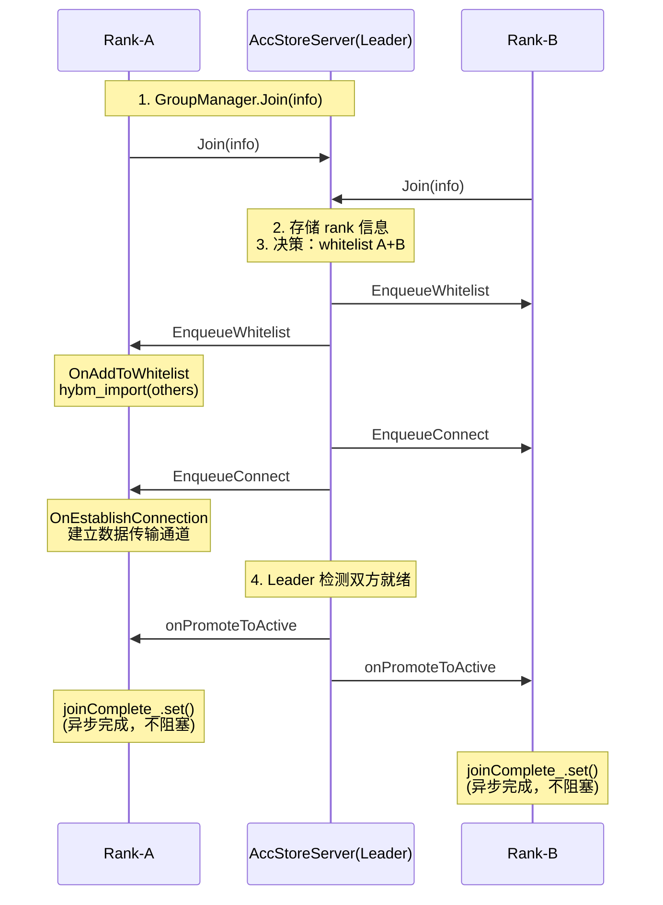

**新方案特点：**

- **Join 完全异步**：promise/future 模式，不阻塞调用线程
- **Server 集中决策**：AccStoreServer（Leader）统一决定 whitelist、connect、promote 时机
- **回调驱动**：OnAddToWhitelist → OnEstablishConnection → onPromoteToActive，状态机清晰
- **Leave 优雅**：OnLeaveNotify 通知已离开 peer 释放资源，不再依赖 barrier

### 1.3 时序对比

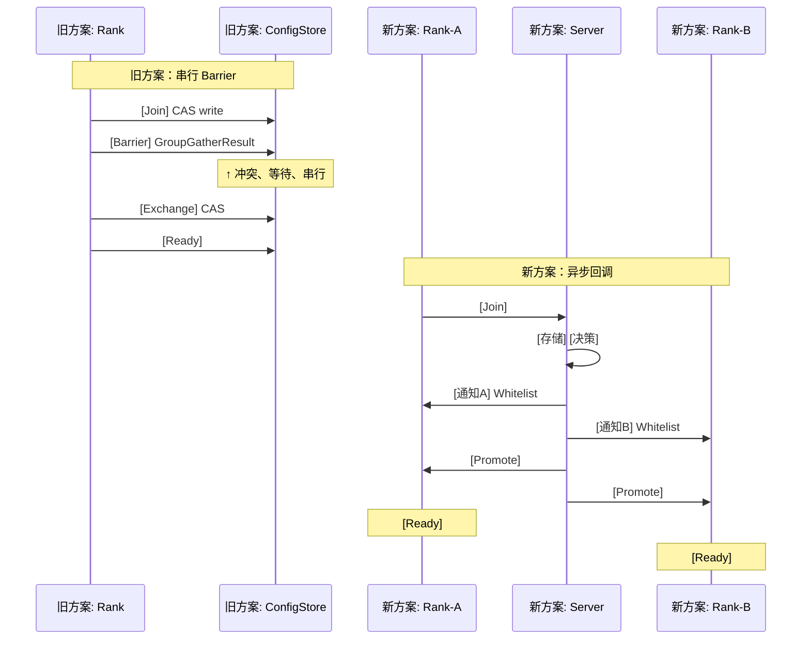

**可定位性优势：**
旧方案的 Join 只有"成功/失败"二值结果，一旦失败无法知道卡在哪个阶段。新方案将 Join 分解为 Whitelist → Connect → Promote 三个独立阶段，每个阶段有独立的回调入口和日志输出（通过 reqId/seqId 串联）。维测时可以精确定位：是 whitelist 没到？还是 connect 没建立？还是 promote 没完成？

---

## 2. 内存扩展流程

### 2.1 旧方案：GroupUpdate + CAS retry

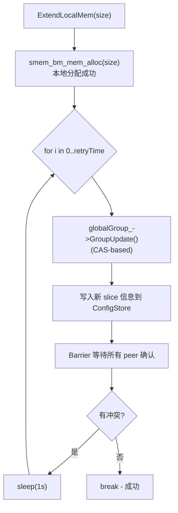

**问题：**

- `GroupUpdate()` 是 CAS + Barrier，在集群规模大时 retry 概率高
- retry 间隔固定 1s，延迟不可控
- UpdateHandle 回调只做简单状态同步，没有增量语义
- 每次 retry 整个 Group，不是增量通知

### 2.2 新方案：ExtendMemory 状态机（state-driven）

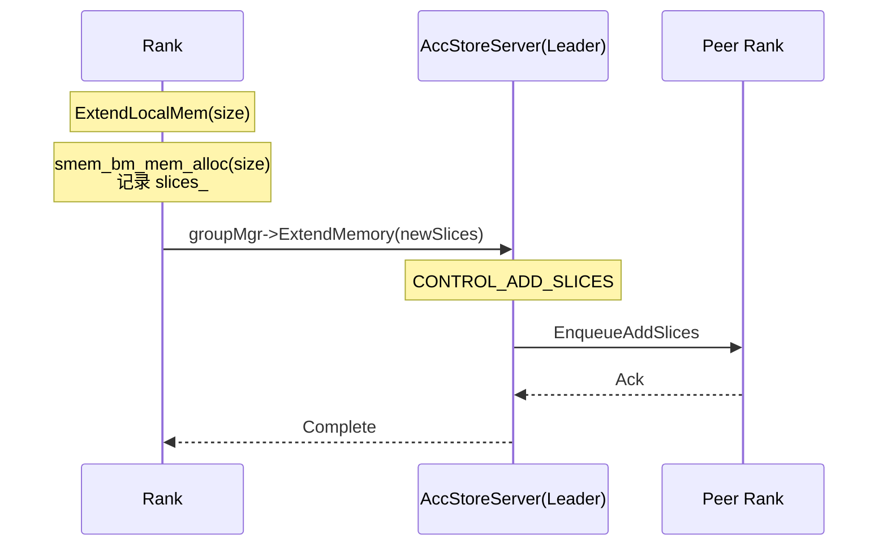

**改进：**

- **去掉了 GroupUpdate 重试循环**：不再需要 CAS retry
- **状态机驱动**：SmemGroupManager::ExtendMemory 接口已定义，通过 CONTROL_ADD_SLICES 消息通知 server
- **增量传播**：只传播新增的 slices，不是全量 GroupUpdate

**维测改进：**
旧方案中 `ExtendLocalMem` 成功与否完全依赖 GroupUpdate 的返回值，一旦 retry 耗尽就只知道"失败了"，无从得知是哪个 peer 冲突、哪一次 CAS 写入失败。新方案的 ExtendMemory 状态机经过 `Prepare → NotifyServer → WaitAck → Complete` 四个阶段，每个阶段都有独立回调。如果某个 peer 长时间未 ack，可以针对性超时，日志里能明确看到卡在哪个 peer、哪个阶段。

---

## 3. 管理面维测能力提升

### 3.1 旧方案的问题

旧方案的维测手段只有两样：

1. **SmemNetGroupEngine 日志**：只有 CAS 操作的成功/失败，信息量极低
2. **GroupEvent 回调**：JOIN_EVENT / LEAVE_EVENT / LINK_DOWN_EVENT 粗粒度事件，没有中间状态

旧方案中管理面执行路径完全分散在各个 rank 本地，**server 侧对各个 rank 的 join/leave 进展是盲区**——server 只知道 ConfigStore 上某个 key 被写入了，不知道谁在操作、操作到哪一步、有没有失败。

### 3.2 新方案提升：Server 侧可查询状态

新方案的核心变化是 **决策权上移到 AccStoreServer（leader）**，因此 server 侧天然拥有全局视图：

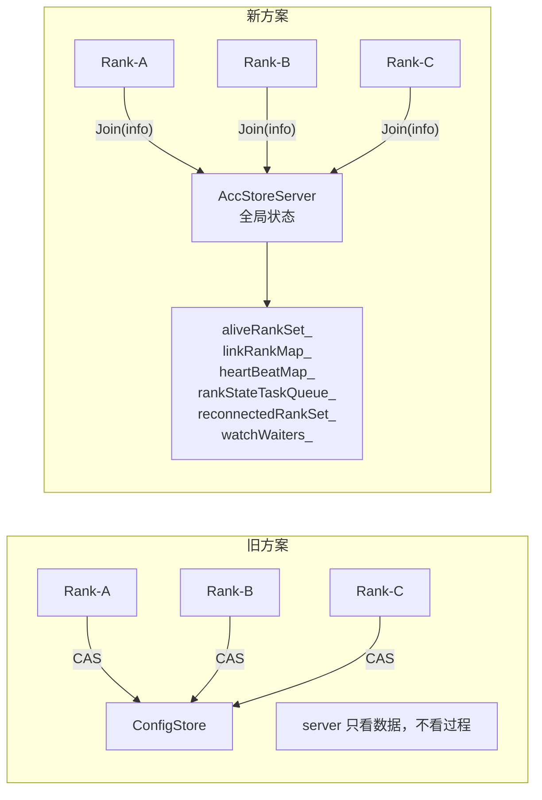

Server 侧可查询的状态包括：

| 状态             | 存储位置                                           | 说明                            |
| ---------------- | -------------------------------------------------- | ------------------------------- |
| alive rank 列表  | `aliveRankSet_`                                    | 当前所有已加入的 rank           |
| 各 rank 链路状态 | `linkRankMap_` + `heartBeatMap_`                   | linkId ↔ rankId 映射 + 心跳时间 |
| 待处理任务       | `rankStateTaskQueue_`                              | 尚未处理的 join/leave 事件队列  |
| 各 rank 主动通知 | `watchWaiters_`                                    | 关注 rank 状态变化的订阅者列表  |
| 持久化状态       | etcd keys: `KEY_ALIVE_RANK_LIST`, `KEY_WORLD_SIZE` | 崩溃恢复时的已知集群拓扑        |

旧方案的 server 侧完全无法获取这些信息——旧 ConfigStore 只是存储层，没有业务语义。新方案的 AccStoreServer 本身就是管理面决策中心，所有状态天然汇聚于此。

### 3.3 细粒度回调与请求追踪

新方案通过 **SmemGroupCommandAsyncDispatcher** 将管理面事件分解为 7 种独立回调：

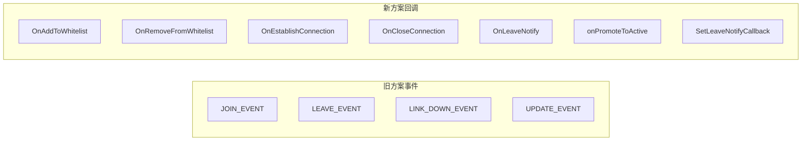

| 回调                   | 触发时机                | 对应旧方案        | 定位价值                     |
| ---------------------- | ----------------------- | ----------------- | ---------------------------- |
| OnAddToWhitelist       | server 将本地加入白名单 | 无                | 明确知道"server 已接受我"    |
| OnRemoveFromWhitelist  | server 将本地移出白名单 | 无                | 明确知道"被踢出"             |
| OnEstablishConnection  | server 通知建立连接     | 隐含在 Join 中    | 知道"连接该建立了"           |
| OnCloseConnection      | server 通知断开连接     | 隐含在 Leave 中   | 知道"连接该断了"             |
| OnLeaveNotify          | peer 离开通知           | LeaveHandle       | 知道"谁离开了"               |
| onPromoteToActive      | 提升为 active 节点      | 隐含在 Barrier 中 | 知道"可以开始工作了"         |
| SetLeaveNotifyCallback | 本节点被要求离开        | 无                | 知道"我是被踢的还是主动退的" |

每个回调都携带 **reqId（请求 ID）**，可以通过日志串联整个过程：

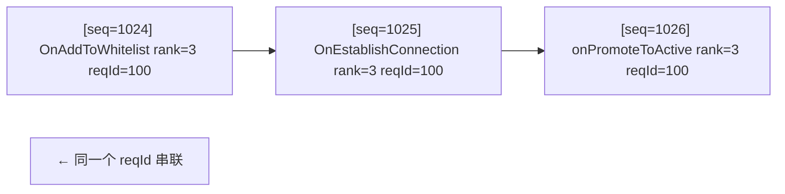

### 3.4 外部维测 API

新方案还暴露了两组外部维测接口：

**1. `smem_bm_get_store_server_info`**（新 C API）

```c
// 上层应用可以随时查询当前连接的 ConfigStore server 地址
int smem_bm_get_store_server_info(char *ip, size_t ipLen, uint16_t *port);
```

旧方案完全无法知道当前连的是哪个 server。新方案通过 TcpConfigStore::GetServerIp/GetServerPort 暴露连接信息，上层可以比对实际 IP 与预期 IP，快速发现配置错误或 DNS 解析异常。

**2. LeaderChangeCallbackV2**（HaConfigStore）

```cpp
struct LeaderAddresses {
    std::string metaServiceAddr;   // MetaService 地址
    std::string configStoreAddr;   // ConfigStore 地址
};
haConfigStore->RegisterLeaderChangeCallbackV2(
    [](bool isLeader, const LeaderAddresses &addrs) {
        LOG_INFO("leaderChange: isLeader=%d, meta=%s, store=%s",
                 isLeader, addrs.metaServiceAddr.c_str(),
                 addrs.configStoreAddr.c_str());
    });
```

旧方案 leader 切换是黑盒。新方案上层可以精确知道"何时、谁成为了 leader，地址是什么"。

---

## 4. 管理面流程打点测试（性能 + 耗时追踪）

新方案的事件驱动架构自然支持在关键路径上插入性能打点，通过时间戳比对获取管理面各阶段的精确耗时。

### 4.1 可打点的关键路径

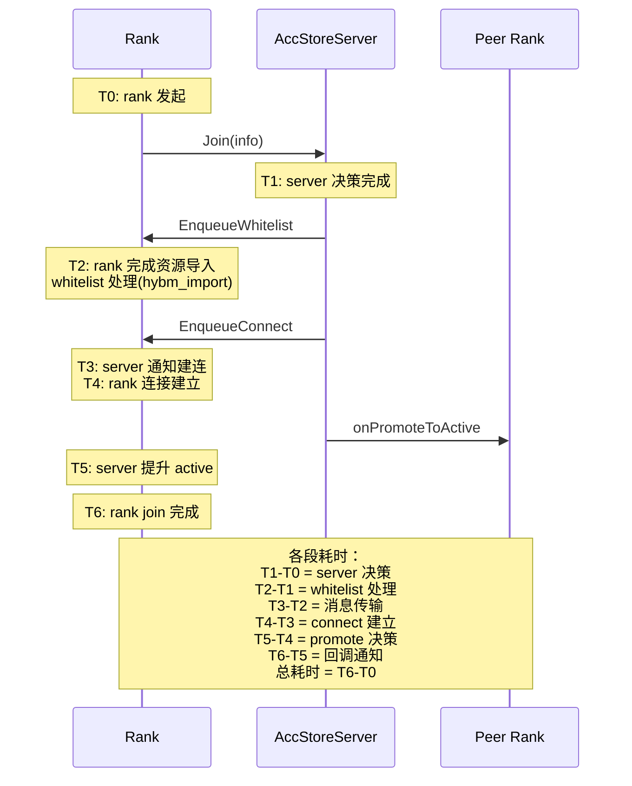

**各段耗时可独立测量：**

| 段             | 计算公式 | 含义                       |
| -------------- | -------- | -------------------------- |
| server 决策    | T1 - T0  | server 接收 + 决策耗时     |
| whitelist 处理 | T2 - T1  | hybm_import 硬件导入耗时   |
| 消息传输       | T3 - T2  | server 调度 + 消息传输耗时 |
| connect 建立   | T4 - T3  | 传输通道建立耗时           |
| promote 决策   | T5 - T4  | server promote 决策耗时    |
| 回调通知       | T6 - T5  | 异步通知回调耗时           |
| 总耗时         | T6 - T0  | 端到端 Join 延迟           |

### 4.2 打点实现方式

在 SmemGroupCommandAsyncDispatcher 的事件处理循环中增加时间戳：

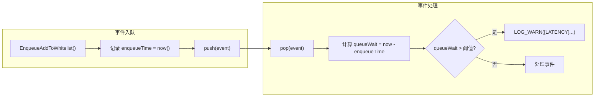

```cpp
// 事件入队时记录时间
void EnqueueAddToWhitelist(uint32_t rankId, std::vector<RankFullInfo> others, uint64_t reqId)
{
    auto startTime = std::chrono::steady_clock::now();
    {
        std::lock_guard<std::mutex> lock(queueMutex_);
        eventQueue_.push({CMD_ADD_TO_WHITELIST, rankId, std::move(others), reqId, startTime});
    }
    queueCv_.notify_one();
}

// 事件出队处理时计算耗时
void ProcessEvents()
{
    while (!stopFlag_) {
        auto event = PopEvent();
        auto now = std::chrono::steady_clock::now();
        auto queueWaitUs = std::chrono::duration_cast<std::chrono::microseconds>(
            now - event.enqueueTime).count();
        if (queueWaitUs > SLOW_THRESHOLD_US) {
            SM_LOG_WARN("[LATENCY] event reqId=" << event.reqId
                        << " type=" << event.type
                        << " queueWait=" << queueWaitUs << "us");
        }
        // 处理事件...
    }
}
```

### 4.3 建议的打点指标

| 指标                   | 测量目标                   | 阈值参考 | 用途               |
| ---------------------- | -------------------------- | -------- | ------------------ |
| `join_total_latency`   | Join 全链路 T0→T6          | < 100ms  | 端到端加入延迟     |
| `join_server_decision` | Server 决策耗时 T1-T0      | < 10ms   | Server 处理能力    |
| `join_whitelist_hybm`  | hybm_import 耗时 T2-T1     | < 50ms   | 硬件资源导入延迟   |
| `join_connect_setup`   | 连接建立耗时 T4-T3         | < 30ms   | 传输通道建立延迟   |
| `extend_memory_ack`    | ExtendMemory peer ack 等待 | < 200ms  | 内存扩展同步延迟   |
| `leave_notify_delay`   | Leave 通知到清理完成       | < 50ms   | 资源释放延迟       |
| `event_queue_depth`    | dispatcher 队列深度        | < 100    | 管理面事件积压情况 |
| `event_queue_wait`     | 事件在队列中等待时间       | < 1ms    | 调度延迟           |

### 4.4 慢路径告警

上述打点配合阈值告警，可以在管理面出现异常时第一时间定位：

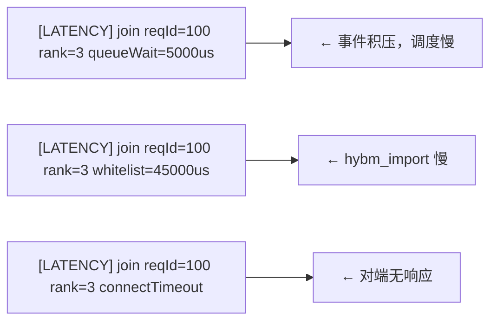

### 4.5 vs 旧方案

旧方案的 Barrier + CAS 机制天然无法做分段打点：

- **GroupGatherResult** 是一次性 barrier，拿到结果时已经是所有 rank 都完成的最终态，无法知道每一段耗时
- **CAS retry** 中即使加耗时统计，也只能看到"retry 了几次"，无法区分是本地 CAS 冲突还是对端处理慢
- 没有 **reqId** 串联机制，多 rank 之间的因果关系无法关联

新方案的事件队列 + reqId 使得全链路耗时追踪变成自然结果——只需要在每个处理节点加时间戳。

---

## 5. 各维度对比

### 5.1 性能

| 方面         | 旧方案                                 | 新方案                                   | 收益                   |
| ------------ | -------------------------------------- | ---------------------------------------- | ---------------------- |
| Join 耗时    | Barrier 同步等待所有 rank（O(n) 串行） | 异步回调 + promise/future（O(1) 不阻塞） | 集群规模越大收益越明显 |
| Update/Leave | GroupUpdate Barrier + retry            | SmemGroupManager::Leave/ExtendMemory     | 去掉 1s sleep retry    |
| CAS 冲突     | 高（ConfigStore CAS 自旋）             | 无（server 集中决策）                    | 高并发场景吞吐提升     |
| 管理面心跳   | SmemNetGroupEngine GFB 空转            | 不依赖 GFB                               | 减少 CPU 空转          |

### 5.2 可定位性

| 方面          | 旧方案                                | 新方案                                                       |
| ------------- | ------------------------------------- | ------------------------------------------------------------ |
| Join 阶段     | Barrier 成功/失败二值，卡在哪一步未知 | 三阶段回调：Whitelist → Connect → Promote，reqId 串联全链路  |
| 内存扩展      | GroupUpdate retry，失败原因不可追踪   | 状态机四阶段：Prepare → NotifyServer → WaitAck → Complete    |
| 节点退出      | LeaveHandle 同步，无法区分主动/被动   | OnLeaveNotify + onPromoteToActive 可以判断"被踢"还是"主动退" |
| 执行路径      | SmemGroupEngine 内部黑盒              | SmemGroupCommandAsyncDispatcher 事件队列可追踪               |
| 失败根因      | 只知道 retry 耗尽                     | 知道哪个 peer、哪个阶段、什么原因                            |
| Server 侧视角 | 盲区（ConfigStore 无业务语义）        | aliveRankSet\_ / linkRankMap\_ / heartBeatMap\_ 全局可见        |
| 耗时打点      | Barrier 统一返回，无法分段            | 每个阶段独立时间戳，全链路 T0~T6 可测                        |

### 5.3 维测（可观测性/可调试性）

| 方面            | 旧方案                                                | 新方案                                                       |
| --------------- | ----------------------------------------------------- | ------------------------------------------------------------ |
| 管理面事件      | GroupEvent 粗粒度（只有 JOIN/LEAVE/LINK_DOWN/UPDATE） | 7 种独立回调，细粒度到 whitelist/connect/promote             |
| 请求追踪        | 无串联标识                                            | 每个回调携带 reqId，日志可串联全生命周期                     |
| Server 地址     | 无暴露接口，无法确认连接目标                          | `smem_bm_get_store_server_info` C API 随时查询               |
| Leader 状态     | 黑盒，上层不知谁在服务                                | LeaderChangeCallbackV2 通知 + 同时返回 metaServiceAddr 和 configStoreAddr |
| 后端暴露        | 无                                                    | HaConfigStore::GetBackend() 暴露 etcd 句柄，可直接查询 etcd 状态 |
| 事件驱动方式    | CAS 轮询（忙等）                                      | dispatcher 事件队列（异步有序）                              |
| Server 状态查询 | 无                                                    | aliveRankSet_、linkRankMap_、heartBeatMap_ 等实时可视        |
| 性能打点        | Barrier 一次性返回，无法分段                          | 每个环节独立时间戳 + 慢路径告警                              |

---

## 6. 总结

本次管理面整改的核心思路是 **"去中心化 CAS + Barrier → 服务端集中决策 + 异步回调"**：

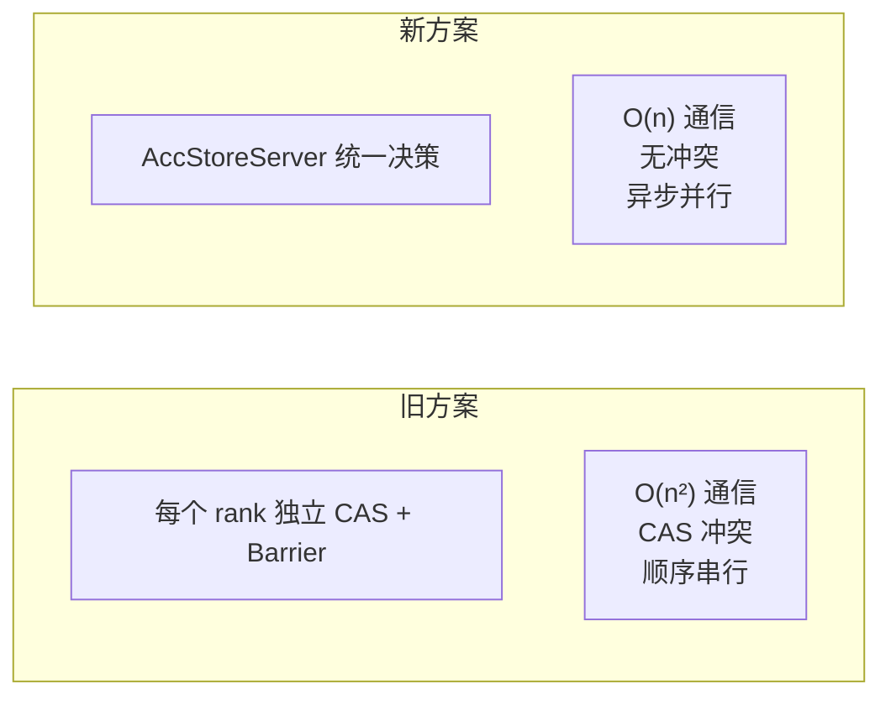

关键收益：

- **性能**：Join 从同步 Barrier 变为异步回调，去掉了 GroupUpdate retry（1s sleep），CAS 冲突归零
- **可定位性**（最大提升）：旧方案只有 Success/Fail 二值，新方案将管理面拆解为 7 种独立回调 × reqId 串联，server 侧全局状态可视（aliveRankSet_、linkRankMap_），可以精确定位到"哪个 peer 在哪个阶段失败"
- **维测**：新增 `smem_bm_get_store_server_info` C API、`LeaderChangeCallbackV2`、`GetBackend()` 接口；基于事件队列可以插入全链路耗时打点，管理面各阶段性能可量化、可告警
