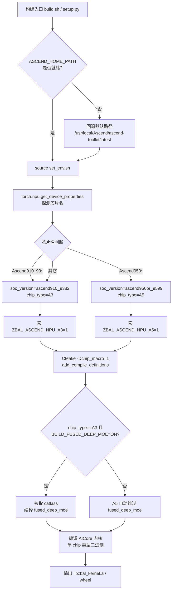
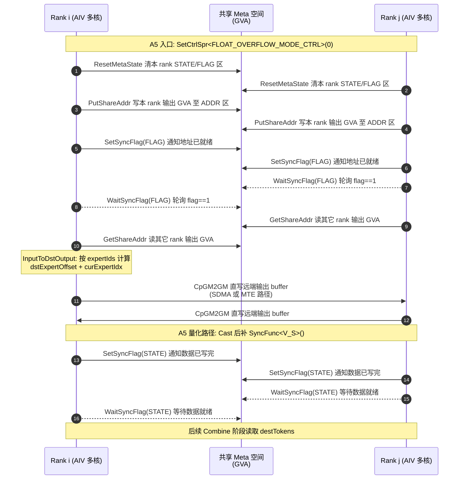
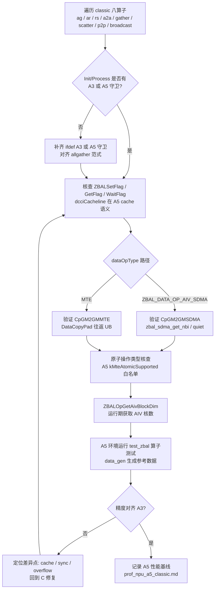
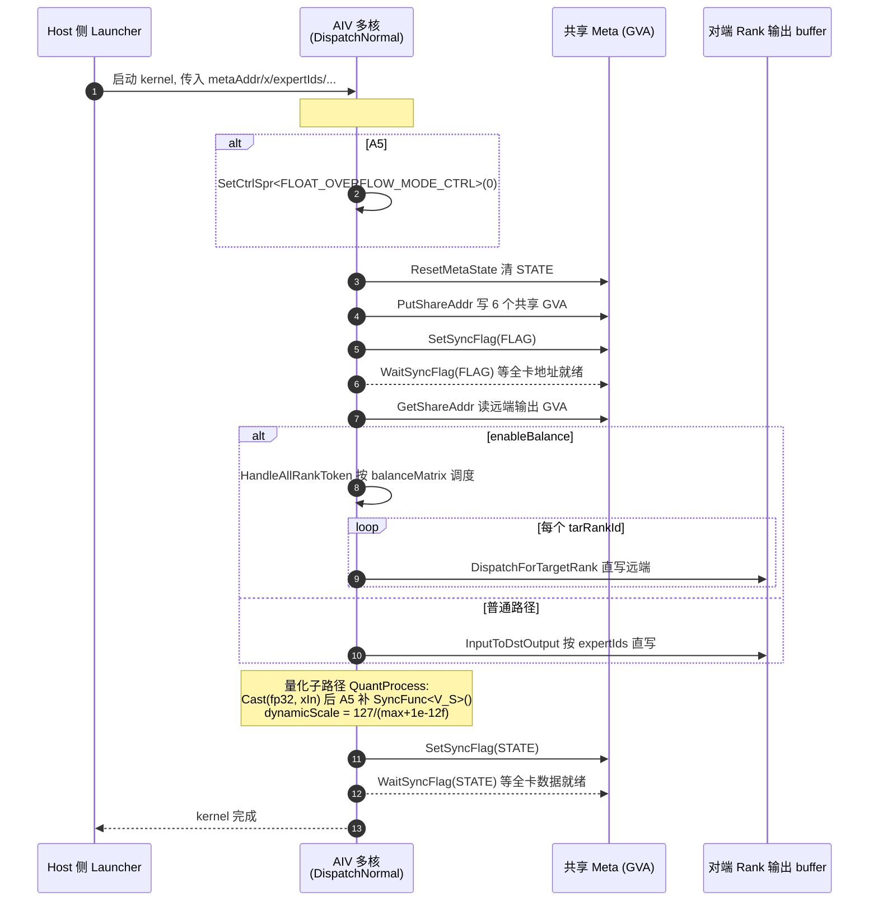
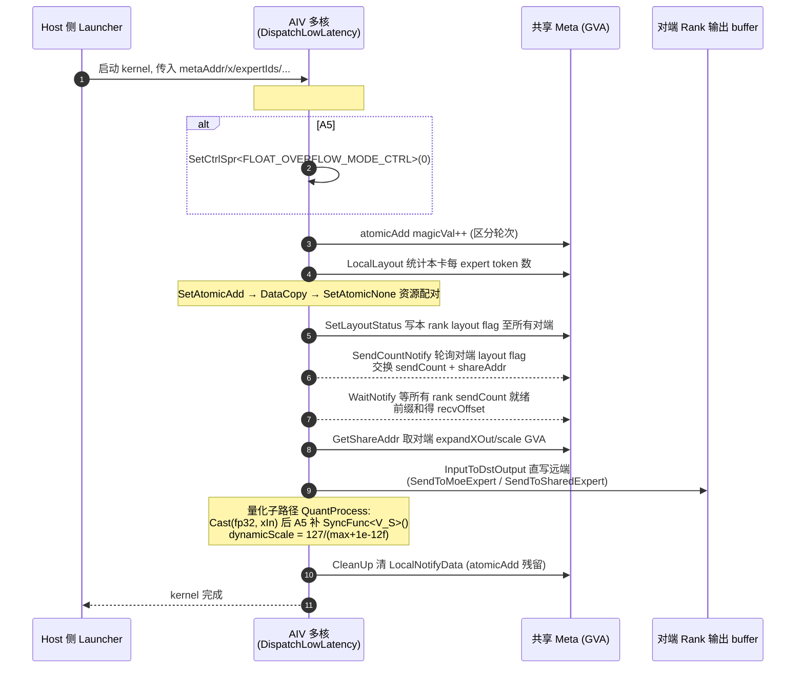
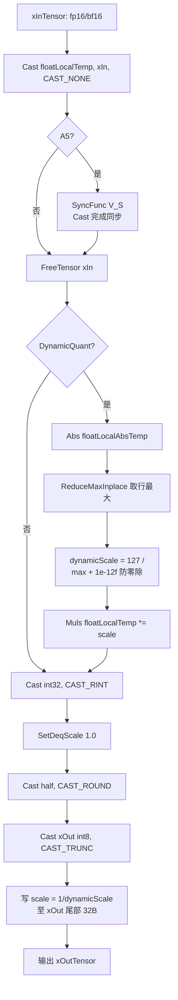
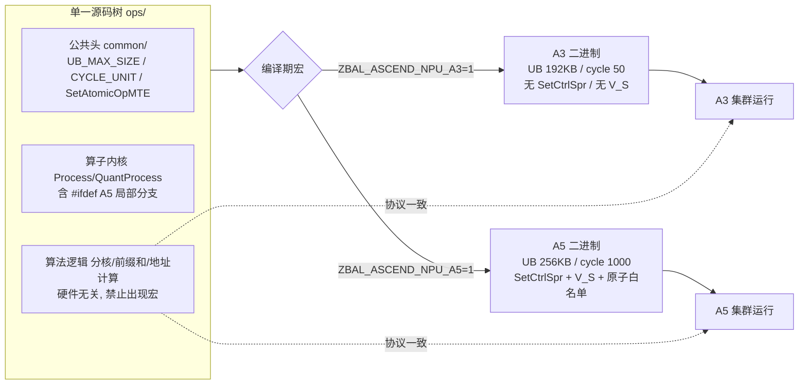

# A5-ZBAL-D&C+Classic算子功能设计文档

**作者 (Authors):** @MemFabric-Team<br>
**创建日期 (Created):** 2026-07-29<br>
**更新日期 (Updated):** 2026-07-29<br>
**相关需求:** ZBAL 算子 Dispatch&Combine LowLatency / Classic / ZeroBuffer 兼容 / Dispatch&Combine Normal 支持 A5 硬件

---

## 1. 概述

### 1.1 简介

本提案围绕 ZBAL（Zero Buffer Acceleration Library）算子库向 A5（Ascend950 系列）硬件的移植与适配展开，覆盖四项相互关联的需求：

- **需求一**：Dispatch&Combine Low Latency 算子支持 A5 硬件，精度正常且纯数据读写带宽达到有效带宽 90%+；
- **需求二**：ZBAL Classic 算子（allgather / allreduce / reducescatter / alltoallv / gather / scatter / p2p / broadcast）支持 A5 硬件，精度正常；
- **需求三**：ZeroBuffer（Dispatch&Combine）设计方案与 A3 共用一套代码，部分特性通过宏隔离，最终在 A3、A5 双平台兼容可运行；
- **需求四**：Dispatch&Combine Normal 算子支持 A5 硬件，精度正常且纯数据读写带宽达到有效带宽 90%+。

核心价值在于：以"单一代码库 + 编译期宏隔离"的方式完成 A3→A5 双硬件兼容，避免分叉维护成本，同时复用 ZeroBuffer 零中转缓冲架构，在 A5 更大的片上存储与更高带宽上达成 90%+ 有效带宽目标。

### 1.2 动机

- **硬件演进驱动**：A5（Ascend950）是 A3（Ascend910_93）之后的下一代 NPU，业务侧要求 ZBAL 在 A5 超算节点上提供与 A3 同等的集合通信与 MoE Dispatch/Combine 能力。
- **现有痛点**：当前 ZBAL 内核代码以 A3 为主目标，部分文件已通过 `ZBAL_ASCEND_NPU_A3` / `ZBAL_ASCEND_NPU_A5` 宏做了初步隔离（如 [zbal_kernel_utils.h:30-L39](../../../../app/zbal/src/csrc/operators/npu/aicore/common/zbal_kernel_utils.h)、[zbal_kernel_base.h:199-L247](../../../../app/zbal/src/csrc/operators/npu/aicore/common/zbal_kernel_base.h)），但 Low Latency 路径尚未补齐 A5 适配；Classic 与 Normal 路径已有 `#if defined(ZBAL_ASCEND_NPU_A3) || defined(ZBAL_ASCEND_NPU_A5)` 守卫但仍需逐算子验证。
- **不做的影响**：若不完成本提案，A5 集群无法运行 ZBAL 的集合通信与 MoE 通信算子，业务模型（如 DeepSeek3.1、Qwen235B MoE）无法在 A5 上推理/训练。

### 1.3 目标

**目标：**

1. Dispatch&Combine Low Latency / Normal 在 A5 上精度正常，纯数据读写带宽达有效带宽 90%+（需求一、四）；
2. Classic 八类算子（ag/ar/rs/a2a/gather/scatter/p2p/broadcast）在 A5 上精度正常（需求二）；
3. Dispatch&Combine 与 A3 共用一套代码，特性差异通过 `ZBAL_ASCEND_NPU_A3` / `ZBAL_ASCEND_NPU_A5` 宏隔离，A3/A5 双平台兼容可运行（需求三）；
4. 构建系统自动识别 A3/A5 并注入对应宏，无需手工切换源码树。

---

## 2. 用例分析（需求分析）

### 2.1 用例总览

| 用例编号 | 对应需求 | 用例名称 | 关键功能点 | 关键性能指标 | 优先级 |
| --- | --- | --- | --- | --- | --- |
| UC-1 | 需求一 | D&C Low Latency on A5 | MoE Dispatch / Combine 低时延算子在 A5 上运行，支持静态/动态量化、共享专家 | 纯数据读写带宽 ≥ 有效带宽 90%+；精度正常 | P0 |
| UC-2 | 需求二 | Classic 集合算子 on A5 | ag/ar/rs/a2a/gather/scatter/p2p/broadcast 八类算子在 A5 上运行 | 精度正常（带宽指标沿用 A3 基线，不回退） | P0 |
| UC-3 | 需求三 | ZeroBuffer A3/A5 双兼容 | Dispatch&Combine 单一代码库，宏隔离特性差异，A3/A5 均可编译运行 | 双平台编译通过、功能等价 | P0 |
| UC-4 | 需求四 | D&C Normal on A5 | MoE Dispatch / Combine 普通模式（含负载均衡 balance）在 A5 上运行 | 纯数据读写带宽 ≥ 有效带宽 90%+；精度正常 | P0 |

### 2.2 功能性要求

- **精度**：所有算子在 A5 上输出与 A3 在相同输入下数值等价（量化算子允许由于浮点 round 模式差异导致的 ULP 级误差，但不得改变模型收敛性）。
- **功能等价**：A3 与 A5 路径行为一致，包括 meta 空间布局、地址交换协议、同步 flag 语义、token 偏移计算。

### 2.3 性能指标

| 算子类别 | 指标 | 目标 | 备注 |
| --- | --- | --- | --- |
| D&C Low Latency (UC-1) | 纯数据读写带宽 / 有效带宽 | ≥ 90% | |
| D&C Normal (UC-4) | 纯数据读写带宽 / 有效带宽 | ≥ 90% |  |
| Classic 八算子 (UC-2) | 带宽 | 不低于 A3 同等比例 |  |
| ZeroBuffer 双兼容 (UC-3) | 编译/功能 | 双平台可运行 | |

### 2.4 安全隐私要求（DFX-安全，四需求统一）

1. 开源代码中不得包含工号 / 问题单等个人信息；
2. 禁止硬编码公网地址（URL、IP、email）；
3. 资源申请与释放严格配对，防止资源泄露（GM/UB buffer、event、flag、atomic 状态）；
4. 日志不打印敏感信息（明文、密文、私钥、token、sessionid 等），包括 debug 日志。

### 2.5 DFX 要求

- **兼容性**：A3（Ascend910_9382，CANN 8.x）与 A5（Ascend950pr_9599，CANN 9+）双平台源码级兼容；同时兼容 PyTorch / DeepEP 适配层。
- **可维护性**：硬件差异集中收敛到 `zbal_defines.h`、`zbal_kernel_utils.h`、`zbal_kernel_base.h`、`zbal_kernel_constant.h` 等公共头，禁止在业务算子内散落裸硬件判断。
- **可测试性**：保留现有 UT 框架（`test/ut/`，mock acl/c10/torch_npu），UT 默认以 A3 宏构建；新增 A5 路径需可被 `--gtest_filter` 覆盖；Python ST（`test/python/operators/`、`test/python/deepep/`）在 A5 环境直接复用。

---

## 3. 方案设计

### 3.1 总体方案

#### 3.1.1 总体架构与硬件抽象层

ZBAL 算子运行在 NPU AIV（AI Vector Core）上，基于 AscendC `kernel_operator` 编程模型，通过 MemFabric 共享虚拟地址（GVA）实现跨 rank 的零中转数据搬运。整体架构保持不变，本提案仅在"硬件能力抽象层"与"算子内核适配点"上做 A3/A5 差异化处理。

```text
┌──────────────────────────────────────────────────────────┐
│  适配层 (adaptor/) : pytorch_npu / deepep                │  ← 硬件无关
├──────────────────────────────────────────────────────────┤
│  通信原语层 (zbal_operations.cpp / zbal_npu_operators.h) │  ← 硬件无关 API
├──────────────────────────────────────────────────────────┤
│  AICPU 执行器 (aicpu/executor/) : 算法选择/SDMA 引擎     │  ← 硬件无关
├──────────────────────────────────────────────────────────┤
│  AICore 内核 (aicore/ops/)                               │
│   ├─ classic/                 (UC-2)                     │  ← 宏隔离
│   ├─ dispatch_combine_low_latency/  (UC-1)               │  ← 宏隔离（待补齐）
│   └─ dispatch_combine_normal/      (UC-4)                │  ← 宏隔离
├──────────────────────────────────────────────────────────┤
│  硬件能力抽象层 (common/)                                │
│   ├─ zbal_defines.h        : ZBAL_CYCLE_UNIT 等          │  ← A3/A5 分支
│   ├─ zbal_kernel_utils.h   : UB_MAX_SIZE / UB_DMA_MAX    │  ← A3/A5 分支
│   ├─ zbal_kernel_base.h    : SetAtomicOpMTE 实现         │  ← A3/A5 分支
│   └─ zbal_kernel_constant.h: CYCLE_TO_TIME 等            │  ← 间接依赖
└──────────────────────────────────────────────────────────┘
```

#### 3.1.2 硬件识别与编译期宏注入

硬件识别在构建期完成，运行期不切换：

1. **Python wheel 构建**（[setup.py:66-105](../../../../app/zbal/src/python/setup.py)）：通过 `torch.npu.get_device_properties()` 自动探测芯片名，`Ascend950*` → `soc_version=ascend950pr_9599`、`_chip_type=A5`、`_chip_macro=ZBAL_ASCEND_NPU_A5`；`Ascend910_93*` → A3。宏以 `define_macros=[(_chip_macro, "1")]` 形式注入 C++ 扩展，并以 `-D${_chip_macro}=1` 传入 CMake。
2. **UT 构建**（[build.sh:118-122](../../../../app/zbal/script/build.sh)）：根据 `SOC_VERSION` 字符串匹配，`Ascend950*` → `chip_type=A5`，否则 `A3`，注入 `ZBAL_ASCEND_NPU_A5` 或 `ZBAL_ASCEND_NPU_A3`。
3. **CMake 转发**（[CMakeLists.txt:62-66](../../../../app/zbal/src/csrc/CMakeLists.txt)）：`ZBAL_ASCEND_NPU_A3` / `ZBAL_ASCEND_NPU_A5` 选项被转为 `add_compile_definitions`。

构建期硬件识别与宏注入流程：



#### 3.1.3 核心逻辑流（ZeroBuffer 共享地址协议，A3/A5 一致）

Dispatch&Combine 的核心是"地址交换 + 远端直写"协议，A3 与 A5 共用同一流程（需求三的"一套代码"基础）：

```text
Rank i                                  Rank j
  │ 1. ResetMetaState (清 STATE/FLAG)     │
  │ 2. PutShareAddr (写本 rank 输出 GVA)  │
  │ 3. SetSyncFlag(FLAG) ────────────────▶│
  │                                       │ 4. WaitSyncFlag(FLAG)
  │                                       │ 5. GetShareAddr (读远端输出 GVA)
  │ 6. WaitSyncFlag(FLAG) ◀────────────────│
  │ 7. InputToDstOutput (CpGM2GM 直写远端) │
  │ 8. SetSyncFlag(STATE) ────────────────▶│
  │                                       │ 9. WaitSyncFlag(STATE) (数据就绪)
```

Low Latency 路径走 magicVal + atomicAdd 的轻量同步（[zbal_kernel_dispatch_low_latency.h:295-316](../../../../app/zbal/src/csrc/operators/npu/aicore/ops/dispatch_combine_low_latency/zbal_kernel_dispatch_low_latency.h)）；Normal 路径走 STATE/FLAG 双 flag 同步（[zbal_kernel_dispatch_normal.h:757-777](../../../../app/zbal/src/csrc/operators/npu/aicore/ops/dispatch_combine_normal/zbal_kernel_dispatch_normal.h)）。两者在 A5 上协议不变。

Normal 路径跨 rank 地址交换与数据直写时序（A3/A5 共用，A5 适配点已 Notes 标注）：



### 3.2 技术选型

| 方案 | 描述 | 优势 | 劣势 | 决策 |
| --- | --- | --- | --- | --- |
| A. 双代码库分叉 | A3、A5 各维护一套 ops 源码 | 可针对硬件极致调优 | 维护成本翻倍，协议漂移风险高，违背需求三 | **放弃** |
| B. 单代码库 + 编译期宏隔离（本提案） | 公共头抽象硬件能力，算子内用 `#ifdef ZBAL_ASCEND_NPU_A5` 局部分支 | 一套代码双平台运行，协议单一真实来源；满足需求三 | 宏分支需谨慎收敛，避免散落 | **采纳** |
| C. 运行期动态分发 | 同一二进制按运行期探测的 chip type 走不同分支 | 单二进制多平台 | 内核态运行期探测代价高、AscendC 模板实例化膨胀 | 放弃 |

选 B 的理由：AscendC 内核为 `__aicore__ inline` 模板，编译期单 chip 类型已确定，运行期分发无收益；宏隔离已在新基线代码中部分建立，扩展成本最低。

### 3.3 功能与性能设计

#### 3.3.1 硬件能力抽象层适配（公共基础，支撑全部四需求）

以下差异点已识别并需在公共头中收敛，是所有算子 A5 适配的基石：

| 差异点 | A3 | A5 | 位置 | 处理方式 |
| --- | --- | --- | --- | --- |
| UB 总容量 | 192 KB | 256 KB | [zbal_kernel_utils.h:30-39](../../../../app/zbal/src/csrc/operators/npu/aicore/common/zbal_kernel_utils.h) | 已分支，A5 用 256KB/240KB |
| Cycle 单位 | 50 | 1000 | [zbal_defines.h:68-72](../../../../app/zbal/src/csrc/common/zbal_defines.h) | 已分支，影响超时阈值换算 |
| MTE 原子算子类型限制 | 无限制 | CANN 9+ 限定 6 种类型（float/half/int16_t/int32_t/int8_t/bfloat16_t） | [zbal_kernel_base.h:199-247](../../../../app/zbal/src/csrc/operators/npu/aicore/common/zbal_kernel_base.h) | A5 用 `kMteAtomicSupported` 白名单 + `if constexpr` 静态分支，避免实例化非法类型 |
| 浮点溢出控制 | 默认 | 需显式 `SetCtrlSpr<FLOAT_OVERFLOW_MODE_CTRL>` | [zbal_kernel_dispatch_normal.h:760-762](../../../../app/zbal/src/csrc/operators/npu/aicore/ops/dispatch_combine_normal/zbal_kernel_dispatch_normal.h) | A5 在 `Process()` 入口设置 `FLOAT_OVERFLOW_MODE_CTRL=60` |
| Cast 后 V_S 同步 | 不需要 | 需要（Cast→FreeTensor 路径） | [zbal_kernel_dispatch_normal.h:464-466](../../../../app/zbal/src/csrc/operators/npu/aicore/ops/dispatch_combine_normal/zbal_kernel_dispatch_normal.h) | A5 在 `QuantProcess` 的 `Cast(floatLocalTemp, xInTensor, ...)` 后补 `SyncFunc<V_S>()` |

#### 3.3.2 需求二：Classic 算子 A5 适配

**现状**：Classic 八算子源码位于 [classic/](../../../../app/zbal/src/csrc/operators/npu/aicore/ops/classic/)，已普遍采用 `#if defined(ZBAL_ASCEND_NPU_A3) || defined(ZBAL_ASCEND_NPU_A5)` 守卫（以 allgather 为例，[zbal_kernel_allgather.h:95-115](../../../../app/zbal/src/csrc/operators/npu/aicore/ops/classic/zbal_kernel_allgather.h)、[269-281](../../../../app/zbal/src/csrc/operators/npu/aicore/ops/classic/zbal_kernel_allgather.h)、[384-448](../../../../app/zbal/src/csrc/operators/npu/aicore/ops/classic/zbal_kernel_allgather.h)）。

**适配工作**：

1. 逐算子核查 allgather / allreduce / reducescatter / alltoallv / gather / scatter / p2p(send/recv) / broadcast / barrier 的 A5 守卫完整性，补齐缺失分支；
2. 验证 `ZBALBaseKernel::CpGM2GM` 走 SDMA 与 MTE 两条路径在 A5 上的正确性（`dataOpType == ZBAL_DATA_OP_AIV_SDMA` 分支，[zbal_kernel_base.h:141-196](../../../../app/zbal/src/csrc/operators/npu/aicore/common/zbal_kernel_base.h)）；
3. 验证 `ZBALSetFlag/ZBALGetFlag/ZBALWaitFlag`（基于 `dcciCacheline`，[zbal_kernel_utils.h:101-125](../../../../app/zbal/src/csrc/operators/npu/aicore/common/zbal_kernel_utils.h)）在 A5 cache 语义下正确；
4. AIV 数量自适应：`ZBALOpGetAivBlockDim` 通过 `AclrtGetAIVCountInCurrentThread` 运行期获取物理核数（[zbal_kernel_utils.h:132-162](../../../../app/zbal/src/csrc/operators/npu/aicore/common/zbal_kernel_utils.h)），A3/A5 通用，无需改动。

**精度验证**：复用 [test/python/operators/](../../../../app/zbal/test/python/operators/) 下各算子的 `data_gen.py` + `test_zbal_*.py`，在 A5 环境运行 `run_all_operators.sh`。

Classic 算子 A5 适配验证流程：



#### 3.3.3 需求四：Dispatch&Combine Normal A5 适配

**现状**：Normal 路径已完成主体 A5 适配（[zbal_kernel_dispatch_normal.h](../../../../app/zbal/src/csrc/operators/npu/aicore/ops/dispatch_combine_normal/zbal_kernel_dispatch_normal.h)、[zbal_kernel_combine_normal.h](../../../../app/zbal/src/csrc/operators/npu/aicore/ops/dispatch_combine_normal/zbal_kernel_combine_normal.h)），关键 A5 适配点已落地：

- `Init` 与 `Process` 主体被 `#if defined(ZBAL_ASCEND_NPU_A3) || defined(ZBAL_ASCEND_NPU_A5)` 包裹（[L172](../../../../app/zbal/src/csrc/operators/npu/aicore/ops/dispatch_combine_normal/zbal_kernel_dispatch_normal.h)、[L759](../../../../app/zbal/src/csrc/operators/npu/aicore/ops/dispatch_combine_normal/zbal_kernel_dispatch_normal.h)）；
- A5 入口 `SetCtrlSpr<FLOAT_OVERFLOW_MODE_CTRL, FLOAT_OVERFLOW_MODE_CTRL>(0)`（[L760-762](../../../../app/zbal/src/csrc/operators/npu/aicore/ops/dispatch_combine_normal/zbal_kernel_dispatch_normal.h)）；
- `QuantProcess` 中 A5 专属 `SyncFunc<V_S>()`（[L464-466](../../../../app/zbal/src/csrc/operators/npu/aicore/ops/dispatch_combine_normal/zbal_kernel_dispatch_normal.h)）；
- 动态量化 scale 计算 A5 增加 `+1e-12f` 防零除（[L478](../../../../app/zbal/src/csrc/operators/npu/aicore/ops/dispatch_combine_normal/zbal_kernel_dispatch_normal.h)）。

**剩余工作**：

1. Combine Normal 内核（[zbal_kernel_combine_normal.h](../../../../app/zbal/src/csrc/operators/npu/aicore/ops/dispatch_combine_normal/zbal_kernel_combine_normal.h)）同步补齐 A5 守卫与 `SetCtrlSpr`；
2. 性能调优：利用 A5 更大的 `UB_MAX_SIZE=256KB` 提升 `eachRoundTokens` 批量（[L524-533](../../../../app/zbal/src/csrc/operators/npu/aicore/ops/dispatch_combine_normal/zbal_kernel_dispatch_normal.h)），目标带宽 90%+；
3. 负载均衡路径 `HandleAllRankToken` / `DispatchForTargetRank` 在 A5 上精度验证（[L608-754](../../../../app/zbal/src/csrc/operators/npu/aicore/ops/dispatch_combine_normal/zbal_kernel_dispatch_normal.h)）。

DispatchNormal::Process 在 A5 上的适配点与执行时序：



#### 3.3.4 需求一：Dispatch&Combine Low Latency A5 适配

**现状**：Low Latency 路径（[zbal_kernel_dispatch_low_latency.h](../../../../app/zbal/src/csrc/operators/npu/aicore/ops/dispatch_combine_low_latency/zbal_kernel_dispatch_low_latency.h)、[zbal_kernel_combine_low_latency.h](../../../../app/zbal/src/csrc/operators/npu/aicore/ops/dispatch_combine_low_latency/zbal_kernel_combine_low_latency.h)）当前**未**包含 `ZBAL_ASCEND_NPU_A5` 守卫，是本次的主要新增工作。

**适配设计**：

1. 在 `DispatchLowLatency::Init` 与 `Process` 增设 `#if defined(ZBAL_ASCEND_NPU_A3) || defined(ZBAL_ASCEND_NPU_A5)` 守卫，对齐 Normal 路径风格；
2. A5 入口补 `SetCtrlSpr<FLOAT_OVERFLOW_MODE_CTRL, FLOAT_OVERFLOW_MODE_CTRL>(0)`；
3. `QuantProcess` 中 `Cast(floatLocalTemp, xInTensor, ...)` 后补 A5 专属 `SyncFunc<V_S>()`（[L933-935](../../../../app/zbal/src/csrc/operators/npu/aicore/ops/dispatch_combine_low_latency/zbal_kernel_dispatch_low_latency.h)），动态量化 scale 增加防零除 `+1e-12f`（对齐 Normal 路径 [L478](../../../../app/zbal/src/csrc/operators/npu/aicore/ops/dispatch_combine_normal/zbal_kernel_dispatch_normal.h)）；
4. `MAX_UB_SIZE = 170 * 1024`（[L35](../../../../app/zbal/src/csrc/operators/npu/aicore/ops/dispatch_combine_low_latency/zbal_kernel_dispatch_low_latency.h)）是 Low Latency 路径私有常量，A5 上可放大至 ~230KB 以提升 `BUFFER_NUM` 命中率，减少单 buffer 回退；
5. Combine Low Latency 同步补齐对称守卫。

DispatchLowLatency::Process 在 A5 上的适配点与执行时序（magicVal + atomicAdd 轻量同步）：



QuantProcess 量化子路径 A5 适配流程（Low Latency 与 Normal 共用范式）：



**精度与性能验证**：复用 [test/python/deepep/test_low_latency.py](../../../../app/zbal/test/python/deepep/test_low_latency.py) 与 [run_test_low_latency.sh](../../../../app/zbal/test/python/deepep/run_test_low_latency.sh)，带宽测试参考 [prof_npu_a3_dc.md](../../../../app/zbal/doc/performance/npu/prof_npu_a3_dc.md) 第 3/4 节的 A3 基线（Deepseek3.1 256exp/8topk/7168hidden/16rank/80bs：Dispatch 80.7us、Combine 82.9us），A5 应达成 90%+ 有效带宽。

#### 3.3.5 需求三：ZeroBuffer A3/A5 单代码库

**设计原则**：以"公共头抽象 + 算子内最小宏分支"实现单代码库双平台兼容。

**单代码库约束清单**：

1. **协议层不变**：地址交换协议、meta 空间布局（`sizeForCommGroupInfo | sizeForParam | sizeForExchangeAddress`，[zbal_kernel_constant.h:28-32](../../../../app/zbal/src/csrc/operators/npu/aicore/common/zbal_kernel_constant.h)）、flag 语义、token 偏移计算在 A3/A5 完全一致；
2. **能力差异集中**：UB 容量、cycle 单位、原子类型白名单、溢出控制、V_S 同步差异仅出现在公共头与算子 `Process/QuantProcess` 入口的少量 `#ifdef` 分支；
3. **宏隔离边界**：禁止在算法逻辑（分核、前缀和、地址计算）中使用硬件宏，仅在 AscendC intrinsic 调用差异点使用；
4. **构建联动**：`BUILD_FUSED_DEEP_MOE` 仅在 `ZBAL_ASCEND_NPU_A3` 时生效（[CMakeLists.txt:68-71](../../../../app/zbal/src/csrc/CMakeLists.txt)），A5 自动跳过 fused_deep_moe 与 catlass 依赖拉取。

单代码库宏隔离与双平台编译流程：



> 图示要点：算法逻辑层（S3）对两平台完全等价，保证需求三的"一套代码、行为一致"；硬件差异仅在 S1（公共头）与 S2（算子入口 2 处以内）通过 `#ifdef` 收敛。

**影响范围**：

- 公共头：`zbal_defines.h`、`zbal_kernel_utils.h`、`zbal_kernel_base.h`、`zbal_kernel_constant.h`（已就绪）；
- 算子层：classic（已就绪，待验证）、dispatch_combine_normal（已就绪，Combine 待补）、dispatch_combine_low_latency（待补）；
- AICPU 执行器与 host 侧 launcher：硬件无关，仅需 A5 编译通过。

#### 3.3.6 影响范围汇总

| 模块 | 路径 | 变更类型 | 说明 |
| --- | --- | --- | --- |
| 公共定义 | `common/zbal_defines.h` | 已就绪 | `ZBAL_CYCLE_UNIT` A5 分支 |
| 公共内核工具 | `aicore/common/zbal_kernel_utils.h` | 已就绪 | `UB_MAX_SIZE` A5 分支 |
| 内核基类 | `aicore/common/zbal_kernel_base.h` | 已就绪 | `SetAtomicOpMTE` A5 白名单 |
| Classic 算子 | `aicore/ops/classic/*` | 验证+补齐 | 八算子守卫核查 |
| D&C Normal | `aicore/ops/dispatch_combine_normal/*` | 验证+补齐 | Combine Normal 守卫 |
| D&C Low Latency | `aicore/ops/dispatch_combine_low_latency/*` | **新增** | Init/Process/QuantProcess 守卫 |
| AICPU 执行器 | `aicpu/executor/*` | 仅编译验证 | 硬件无关 |
| 构建脚本 | `CMakeLists.txt`、`script/build.sh`、`src/python/setup.py` | 已就绪 | 宏注入与 chip 探测 |

### 3.4 安全隐私与 DFX 设计

#### 3.4.1 安全设计（对应需求 DFX-安全 1~4）

1. **个人信息**：所有新增/修改代码不得引入工号、问题单号、内部 URL；commit 前由 `pre-commit` 钩子与 [SECURITYNOTE.md](../../SECURITYNOTE.md) 约束。
2. **硬编码公网地址**：内核/Host 代码中禁止出现 URL/IP/email 字面量；现有 [setup.py:355](../../../../app/zbal/src/python/setup.py) 的 `url` 字段为项目官方 gitcode 地址，属合规例外。
3. **资源配对**：
   - `SetAtomicAdd` 必须配对 `SetAtomicNone`（参考 [zbal_kernel_dispatch_low_latency.h:300-304](../../../../app/zbal/src/csrc/operators/npu/aicore/ops/dispatch_combine_low_latency/zbal_kernel_dispatch_low_latency.h) 范式）；
   - `AllocTensor` 必须配对 `FreeTensor`（参考 [zbal_kernel_base.h:165-171](../../../../app/zbal/src/csrc/operators/npu/aicore/common/zbal_kernel_base.h)）；
   - `SetFlag/WaitFlag` 配对，`SyncAll<true>` 跨核同步成对出现；
   - GM/UB `InitBuffer` 与算子生命周期绑定，禁止重复 Init 同一 TBuf。
4. **日志脱敏**：`ZBAL_LOG_ERROR` / `ZBAL_OP_LOGE` 仅打印非敏感的诊断参数（rankId、groupSize、moeExpertNum、retCode 等），禁止打印数据指针内容、token 数据、scale 数值；debug 日志同理。错误返回路径需记录根因与关键参数（如 `epRankId`、`epWorldSize`、`moeExpertNum`、`shareAddrNum`），符合 AGENTS.md 错误日志规范。

#### 3.4.2 DFX 设计

- **兼容性**：A3/A5 双平台源码兼容；CANN 8.x（A3）与 CANN 9+（A5）API 差异由 [dl_cann_api](../../../../app/zbal/src/csrc/under_api/cann/) 动态加载层吸收。
- **可维护性**：硬件差异收敛于 4 个公共头；算子内宏分支不超过 2 处（`Process` 入口 + `QuantProcess` Cast 后），单函数行数 ≤50、嵌套 ≤4 层（遵循 AGENTS.md）。
- **可测试性**：
  - UT：`test/ut/testcase/csrc/ccl/` 覆盖 communicator / group_meta / bootstrap；A5 路径通过 `cmake -DZBAL_ASCEND_NPU_A5=1` 构建 UT 二进制；
  - ST：`test/python/operators/run_all_operators.sh` 与 `test/python/deepep/run_test_{normal,low_latency}.sh` 在 A5 环境直接复用；
  - 性能：复用 [test/python/deepep/perf_fused_deep_moe.py](../../../../app/zbal/test/python/deepep/perf_fused_deep_moe.py) 框架扩展 D&C 带宽用例。
- **可靠性**：
  - `assert(comm->sizeForExchangeAddress >= META_FLAG_R_OFFSET * 2, ...)` 在 Init 阶段校验 meta 空间（[zbal_kernel_dispatch_normal.h:195-199](../../../../app/zbal/src/csrc/operators/npu/aicore/ops/dispatch_combine_normal/zbal_kernel_dispatch_normal.h)），A5 同样生效；
  - 超时检测 `TIMEOUT_DETECTION_THRESHOLD=5e9` 配合 A5 `ZBAL_CYCLE_UNIT=1000` 防止误判；
  - 同步 flag 等待循环（`ZBALWaitFlag`）有上限保护由上层超时机制兜底。

### 3.5 编程与调用设计

#### 3.5.1 编程模型基本设计

**开发环境**：

- 硬件：A5（Ascend950pr_9599）或 A3（Ascend910_9382）NPU 环境；
- 工具链：CANN（A5 配套版本）+ HDK；GCC ≥11.4；Python ≥3.10；PyTorch + torch_npu；CMake ≥3.12；
- 构建：`bash app/zbal/script/build.sh`（wheel）或 `bash script/build_and_pack_run.sh`（项目级，RELEASE，Python ON，XPU_TYPE=NPU）。

**开发约束**：

- 内核代码使用 AscendC `kernel_operator.h`，`__aicore__ inline` 模板；
- 硬件差异必须经 `ZBAL_ASCEND_NPU_A3` / `ZBAL_ASCEND_NPU_A5` 宏隔离，禁止运行期 chip 判断；
- 单函数 ≤50 行（非空非注释），嵌套 ≤4 层，行宽 ≤120（遵循 AGENTS.md）。

**可验收设计**：

- 功能验收：A5 环境 `bash app/zbal/test/python/operators/run_all_operators.sh` 全量通过；`run_test_normal.sh` / `run_test_low_latency.sh` 全量通过；
- 性能验收：D&C Normal / Low Latency 纯数据读写带宽 ≥ 有效带宽 90%+，测试报告输出到 `doc/performance/npu/prof_npu_a5_dc.md`（新增）；
- 安全验收：`bash script/ci-pre-commit-pr.sh` 通过；无个人信息、无硬编码公网地址、资源配对检查通过。

#### 3.5.2 接口定义与设计

本提案**不新增、不修改**任何对外 API。所有算子入口原型保持不变（见 [zbal_npu_operators.h](../../../../app/zbal/src/csrc/operators/npu/zbal_npu_operators.h)）。以 Dispatch Normal 为例：

##### 3.5.2.1 ZBALOpDispatchNormal（已存在，无变更）

- **接口描述**：MoE Dispatch 普通模式，将本地 token 按 expertIds 分发至各 rank 的输出 buffer。
- **接口原型**：见 [zbal_npu_operators.h:58-62](../../../../app/zbal/src/csrc/operators/npu/zbal_npu_operators.h)。
- **输入/输出参数**：`srcTokens`、`topkIndex`、`sendTokensIndex`、`pushTargetOffset`、`balanceMatrix`、`expertNum`、`quantMode`、`destTokens`、`destScale`、`enableBalance`、`stream`、`groupInfo`、`flags`。
- **约束**：A3/A5 通用；A5 下 `groupInfo.dataOpType` 取 `ZBAL_DATA_OP_AIV_SDMA` 或 MTE 由运行期配置决定。
- **变更说明**：无对外变更；内部内核 `DispatchNormal::Process` 在 A5 增设 `SetCtrlSpr` 与 `V_S` 同步。

其余 Classic 算子（`ZBALOpAllGather` 等）、Low Latency 算子（`ZBALOpDispatchLowLatency` / `ZBALOpCombineLowLatency`）、Combine Normal（`ZBALOpCombineNormal`）同理，原型不变，仅内核实现 A5 适配。

#### 3.5.3 编程手册设计

更新现有 [doc/api/](../../../../app/zbal/doc/api/) 与 [doc/user_guide/get_started.md](../../../../app/zbal/doc/user_guide/get_started.md)：

- 在 `get_started.md` 增加"A5 环境构建"小节，说明 `ASCEND_HOME_PATH` 指向 A5 CANN、构建脚本自动探测芯片类型；
- 在 `doc/performance/npu/` 新增 `prof_npu_a5_dc.md` 与 `prof_npu_a5_classic.md`，记录 A5 性能基线；
- API 手册无需变更，仅在 `env.md` 补充 A5 相关环境变量（如 `ASCEND_HOME_PATH` 指向 A5 安装目录）。

---

## 4. 缺点和风险

| 风险 | 类别 | 影响 | 应对措施 |
| --- | --- | --- | --- |
| A5 MTE 原子类型白名单限制 | Breaking Change | `CpGM2GMMTE` 以 `uint64_t`/`long` 等非白名单类型实例化原子操作时，A5 上静默 no-op（已用 `if constexpr` 规避） | 保持 `kMteAtomicSupported` 白名单（[zbal_kernel_base.h:222-246](../../../../app/zbal/src/csrc/operators/npu/aicore/common/zbal_kernel_base.h)）；新增原子调用点必须复核类型 |
| Low Latency 路径 A5 守卫缺失 | 功能缺失 | 需求一无法达成 | 按 3.3.4 补齐 `Init/Process/QuantProcess` 守卫与 `SetCtrlSpr`/`V_S` |
| A5 cycle unit 放大 20x | 可靠性 | 超时检测换算偏差，可能延迟告警 | 已在 `zbal_defines.h` 分支处理；验证 `TIMEOUT_DETECTION_THRESHOLD` 在 A5 实际cycle下仍为合理 wall-clock |
| fused_deep_moe A3 专属 | 兼容性 | A5 用户无法使用 fused_deep_moe | CMake 自动跳过（[CMakeLists.txt:68-71](../../../../app/zbal/src/csrc/CMakeLists.txt)）；DeepEP 适配层在 A5 退化为 D&C Normal+Gemm 分离调用 |
| 性能回退 | 性能 | A5 初版带宽可能未达 90% | 利用 A5 更大 UB 提升 `eachRoundTokens`；按 [prof_npu_a3_dc.md](../../../../app/zbal/doc/performance/npu/prof_npu_a3_dc.md) 基线逐用例调优 |
| 宏分支散落 | 可维护性 | 硬件判断散入算子内部 | 代码审查强约束：宏仅允许出现在公共头与算子 `Process/QuantProcess` 入口；pre-commit 增加 grep 检查 |

---

## 5. 现有技术

- **AscendC kernel_operator**：A3/A5 统一编程模型，差异由 CANN 头文件吸收，本提案沿用其 `GlobalTensor`/`LocalTensor`/`DataCopyPad`/`SyncFunc` 抽象。
- **A3 现有 ZBAL 实现**：[classic/](../../../../app/zbal/src/csrc/operators/npu/aicore/ops/classic/) 与 [dispatch_combine_normal/](../../../../app/zbal/src/csrc/operators/npu/aicore/ops/dispatch_combine_normal/) 已建立 A3/A5 双宏守卫范式，本提案将 Low Latency 路径对齐该范式。
- **PyTorch process group 适配**：[zbal_pytorch_process_group.cpp](../../../../app/zbal/src/csrc/adaptor/pytorch_npu/) 提供 c10d Backend 接入，硬件无关，A5 直接复用。
- **DeepEP 适配**：[zbal_deepep.cpp](../../../../app/zbal/src/csrc/adaptor/deepep/) 在 A5 上调用 D&C Normal/Low Latency，不依赖 fused_deep_moe。

差异点：本提案强调"单代码库 + 宏隔离"而非分叉，区别于一般多硬件移植项目的双代码库思路。

---

## 6. 未解决问题

- [ ] A5 上 `UB_MAX_SIZE=256KB` 时 Low Latency 路径私有 `MAX_UB_SIZE`（当前写死 170KB）应放大到何值最优？需性能实验确定（建议 230KB，预留 26KB 给 flag/workspace）。
- [ ] A5 `SetCtrlSpr<FLOAT_OVERFLOW_MODE_CTRL>` 是否需要应用到 Classic 八算子？还是仅限含 Cast/量化路径的 D&C 算子？需 A5 精度实验确认。
- [ ] A5 上 `ZBAL_DATA_OP_AIV_SDMA` 与 MTE 路径的性能临界点是否与 A3 一致？需在 [ZBALOpGetAivBlockDim](../../../../app/zbal/src/csrc/operators/npu/aicore/common/zbal_kernel_utils.h) 的 `allgatherRankCoreMapping` 中补充 A5 数据点。
- [ ] A5 性能基线文档 `prof_npu_a5_dc.md` / `prof_npu_a5_classic.md` 的具体数值待 A5 环境实测后填充。

---

## 附录

### 参考资料

- 需求来源：`A5-with-D&C-classic.txt`
- 模板：[.agents/skills/technical-design-proposal/template.md](../../../../.agents/skills/technical-design-proposal/template.md)
- 项目规范：[AGENTS.md](../../../../AGENTS.md)
- A3 性能基线：[prof_npu_a3_dc.md](../../../../app/zbal/doc/performance/npu/prof_npu_a3_dc.md)、[prof_npu_a3_classic.md](../../../../app/zbal/doc/performance/npu/prof_npu_a3_classic.md)

### 术语表

| 术语 | 含义 |
| --- | --- |
| ZBAL | Zero Buffer Acceleration Library，零中转缓冲加速库 |
| ZeroBuffer | 零中转缓冲：算子直接通过共享 GVA 写入对端输出 buffer，无中间拷贝 |
| A3 | Ascend910_9382（CANN 8.x） |
| A5 | Ascend950pr_9599（CANN 9+） |
| D&C | Dispatch & Combine，MoE 专家并行通信算子 |
| Low Latency | 低时延模式，magicVal + atomicAdd 轻量同步 |
| Normal | 普通模式，STATE/FLAG 双 flag 同步，支持负载均衡 |
| Classic | 集合通信算子（ag/ar/rs/a2a/gather/scatter/p2p/broadcast） |
| GVA | Global Virtual Address，MemFabric 共享虚拟地址 |
| UB | Unified Buffer，AIV 片上存储 |
| AIV | AI Vector Core，向量核 |
| AICPU | AI CPU，控制核，负责算法选择与 SDMA 调度 |

### 文档更新计划

- A5 环境就绪后：填充第 6 节性能基线数值，关闭未解决问题；
- 实现完成后：在第 3.3 节各小节补充实际变更文件清单与 commit hash；
- 验收通过后：将本文档归档至 `app/zbal/doc/design/`。
