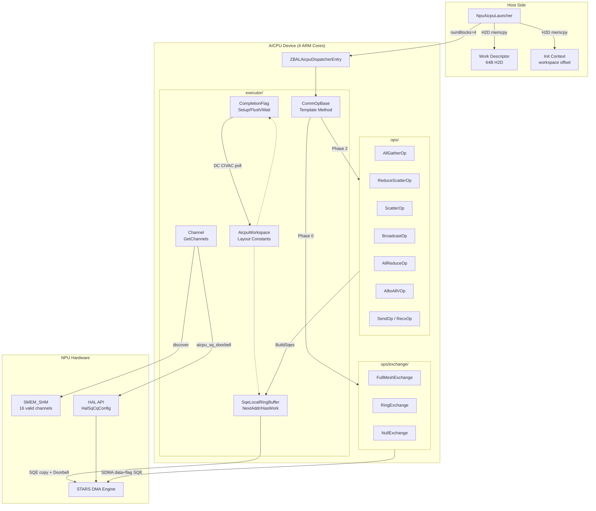
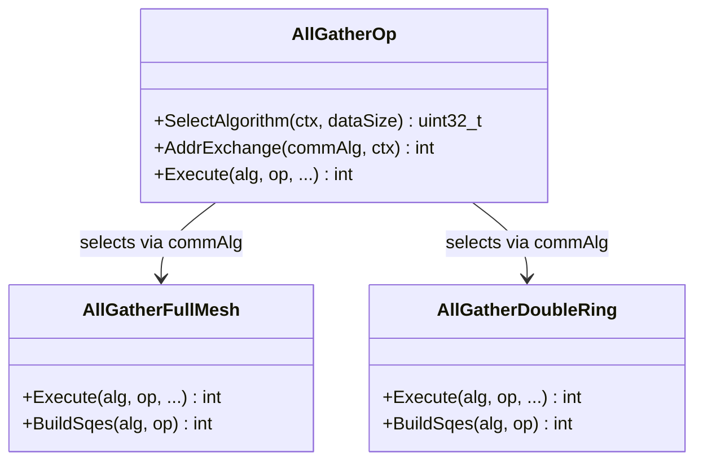
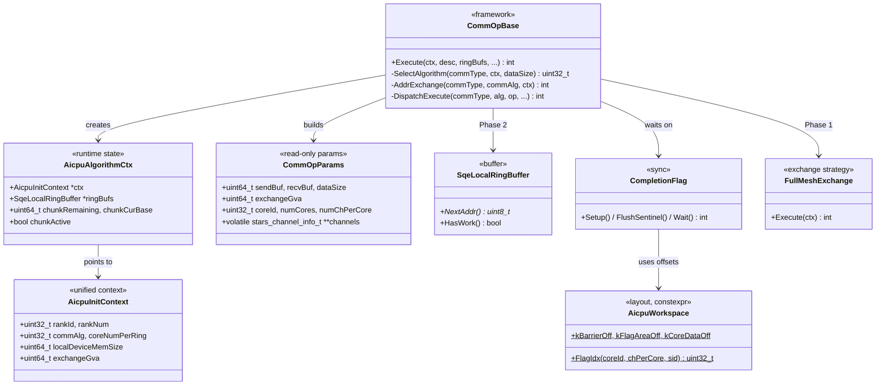
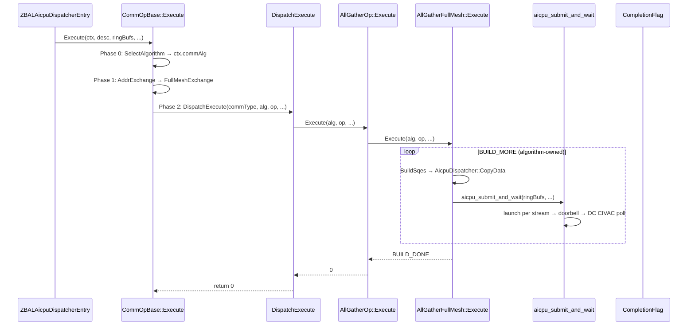
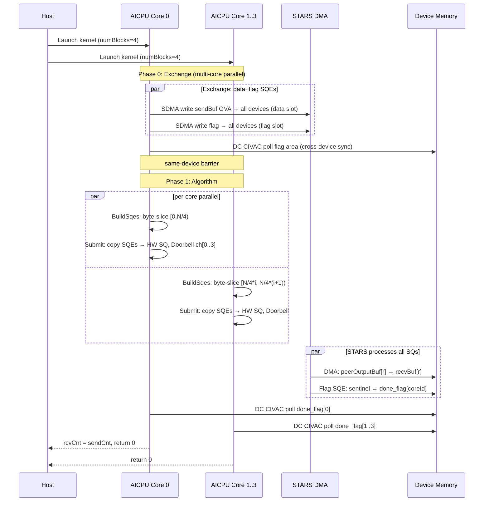
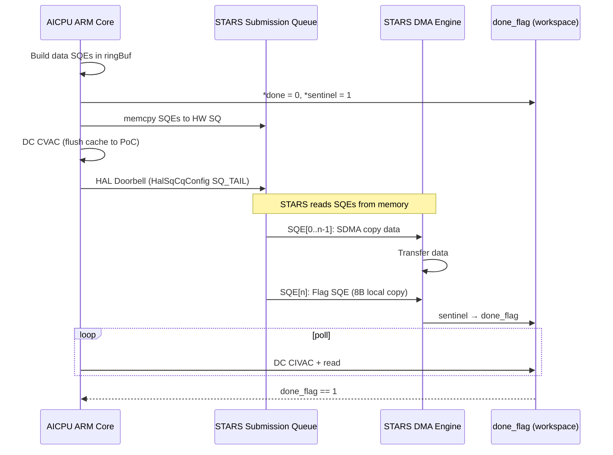
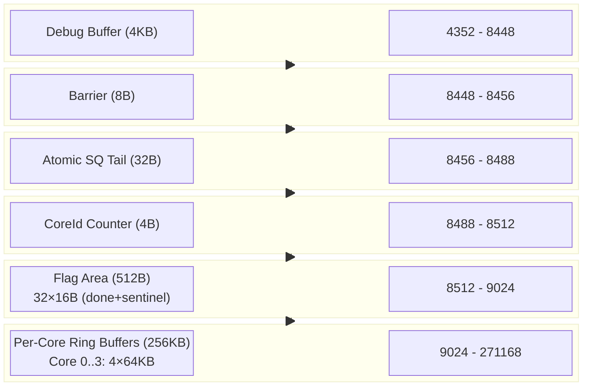
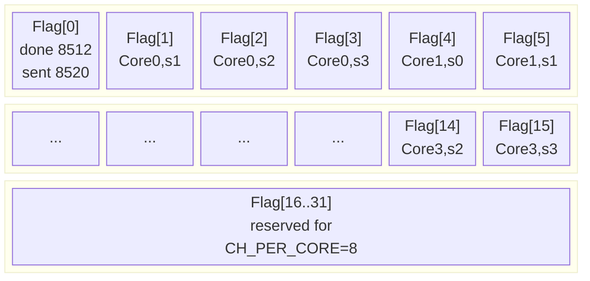
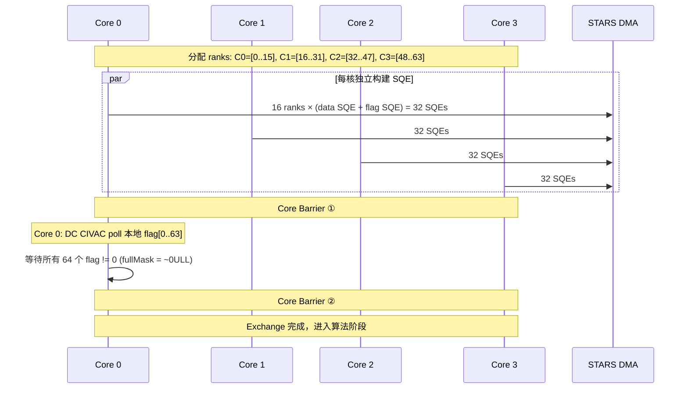
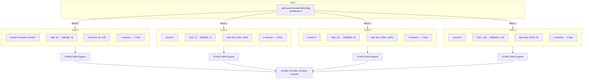

# AICPU SDMA 通信框架设计文档

## 目录

[TOC]

---

## 1. 概述

AICPU 通信框架运行在华为昇腾 NPU 的 AICPU 核心（ARM CPU）上，负责构建 SDMA SQE（Submission Queue Entry）并提交给 STARS DMA 引擎进行跨设备数据传输。Host 侧无需参与交换——AICPU 内核 Phase 0 完成跨设备地址交换（SDMA 远端写 + flag 同步），Phase 1 执行算法。

**核心技术栈**:

- AICPU ARM 核心（4 核，C++17）
- STARS DMA 引擎（hardware SQ/CQ，支持 memcpy + reduce）
- SMEM_SHM（16 有效 channel，发现 + 复用）
- HAL API（HalSqCqConfig Doorbell）
- AICPU Exchange（SDMA 远端写 + flag 跨设备同步，DC CIVAC 轮询）
- CompletionFlag 完成检测（DC CIVAC 轮询）
- SDMA reduce（sqe->opcode ≠ 0，硬件规约）

**已支持算子**: AllGather（FullMesh / DoubleRing）、ReduceScatter（SDMA reduce）、AllReduce（RS+AG）、Scatter、Broadcast、AlltoAllV、Send、Recv

---

## 2. 目录结构

```text
aicpu/
├── DESIGN.md                          # 本文档
├── zbal_aicpu_kernel.cpp              # AICPU 内核入口
├── executor/                         # 框架层
│   ├── zbal_aicpu_defines.h           # 核心常量和数据结构
│   ├── zbal_aicpu_workspace.h         # 工作区布局
│   ├── zbal_aicpu_comm_alg.h          # 算法接口 + 上下文 + 参数
│   ├── zbal_aicpu_comm_op.h           # CommOpBase 模板方法 + 工厂
│   ├── zbal_aicpu_channel.h           # Channel::GetChannels + 门铃自由函数
│   ├── zbal_aicpu_flag.h              # CompletionFlag 完成检测
│   ├── zbal_aicpu_sqe.h               # SQE 硬件结构体 + 填充函数
│   ├── zbal_aicpu_sqe_context.h       # SqeLocalRingBuffer + 提交函数
│   ├── zbal_aicpu_dispatcher.h        # SQE 分发（CopyData）
│   ├── zbal_aicpu_thread.h              # 多核协调（Barrier、Atomic Tail）
│   ├── zbal_aicpu_debug.h             # 调试缓冲区
│   └── zbal_aicpu_sdma_info.h         # SDMA 地址信息
├── ops/                               # 通信算子层（按通信语义分类）
│   ├── allgather/                     # AllGather (FullMesh + DoubleRing)
│   ├── reduce_scatter/                # ReduceScatter (SDMA reduce)
│   ├── allreduce/                     # AllReduce (RS + AG)
│   ├── scatter/                       # Scatter (root→all)
│   ├── broadcast/                     # Broadcast (root→all)
│   ├── alltoallv/                     # AlltoAllV (N-to-N)
│   └── p2p/                           # Send + Recv
└── exchange/                          # AICPU 地址交换策略
    ├── zbal_aicpu_exchange.h           # ExchangeContext + 策略接口
    └── zbal_aicpu_exchange_impl.h      # FullMeshExchange + RingExchange + NullExchange
```

---

## 3. 整体架构

```text
┌─────────────────────────────────────────────────────────────┐
│                       Host Side                             │
│  NpuAicpuLauncher                                           │
│  ├─ Init(JSON) → 加载内核 → 写入 InitContext                 │
│  ├─ Prepare() → H2D 写入 work descriptor                  │
│  └─ Execute() → LaunchKernel(numBlocks=4)     │
│       └─ aclrtLaunchKernelWithConfig()                       │
└──────────────────────┬──────────────────────────────────────┘
                       │
┌──────────────────────▼──────────────────────────────────────┐
│                    AICPU Device Side                         │
│                                                              │
│  ┌─────────────────────────────────────────────────────┐    │
│  │              ZBALAicpuDispatcherEntry                │    │
│  │  ├─ 原子计数器分配 coreId (0-3)                      │    │
│  │  ├─ 每核独立 DlHalApi::Load() (L1 缓存不可见)        │    │
│  │  ├─ Channel::GetChannels 扫描 SMEM 通道             │    │
│  │  └─ CommOpBase::Execute() ──► 模板方法              │    │
│  └─────────────────────────────────────────────────────┘    │
│                          │                                   │
│     ┌────────────────────┼────────────────────┐             │
│     ▼                    ▼                    ▼             │
│  Core 0              Core 1      Core 2      Core 3          │
│  ch[0..3]            ch[4..7]    ch[8..11]   ch[12..15]      │
│  byte[0,N/4)         byte[N/4,2N/4)        byte[3N/4,N)     │
│     │                    │                    │             │
│     ▼                    ▼                    ▼             │
│  ┌──────────────────────────────────────────────────┐       │
│  │          CommOpBase::Execute 模板方法            │       │
│  │  0. SelectAlgorithm (决策层)                      │       │
│  │  1. AddrExchange (Phase 0: 跨设备交换)        │       │
│  │  2. DispatchExecute  → 算子.Execute               │       │
│  │     算法自持 build-submit-wait 循环               │       │
│  └──────────────────────────────────────────────────┘       │
└──────────────────────────────────────────────────────────────┘
```

### 3.1 组件图



### 3.2 Strategy 模式 — 算法可替换



每个算法同一接口：`Execute`（封装 loop）+ `BuildSqes`（构造 SQE）。静态 duck-typing，编译器在 `DispatchExecute` switch-case 中做静态分发。

### 3.3 类图



### 3.4 策略调用链



### 3.5 Template Method 模式 — 统一执行流程

```text
CommOpBase::Execute(ctx, desc, ringBufs, channels, workspace, coreId, numCores):
  ┌──────────────────────────────┐
  │ Phase 0: SelectAlgorithm()   │  ← 决策层：选择最优算法
  │ Phase 1: AddrExchange()  │  ← 交换层：跨设备地址交换
  │ Phase 2: DispatchExecute()   │  ← 分发到算子
  │   └─ Op::Execute()           │
  │       └─ Algorithm::Execute()│  ← 算法自持 loop
  │           do:                │
  │             BuildSqes()      │
  │             aicpu_submit_and_wait()
  │           while BUILD_MORE   │
  └──────────────────────────────┘
```

`aicpu_submit_and_wait()` 是 `sqe_context.h` 中的自由函数，batch submit + parallel wait。BUILD_MORE 机制支持 DoubleRing 的 ring 迭代和 FullMesh 的单批次返回。

### 3.6 Factory 模式 — 算子注册

```text
DispatchExecute(commType, ...):
  ZBAL_CMD_ALLGATHER      → AllGatherOp::Execute
  ZBAL_CMD_REDUCE_SCATTER → ReduceScatterOp::Execute
  ZBAL_CMD_SCATTER        → ScatterOp::Execute
  ZBAL_CMD_BROADCAST      → BroadcastOp::Execute
  ZBAL_CMD_ALLREDUCE      → AllReduceOp::Execute
  ZBAL_CMD_ALLTOALLV      → AlltoAllVOp::Execute
  ZBAL_CMD_SEND           → SendOp::Execute
  ZBAL_CMD_RECV           → RecvOp::Execute

AddrExchange(commType, commAlg, ctx):
  ZBAL_CMD_ALLGATHER      → AllGatherOp::AddrExchange (FullMesh / Ring)
  ZBAL_CMD_SEND/RECV      → NullExchange
  default                 → NullExchange
```

添加新算子：创建 `ops/<name>/`，实现 `AddrExchange` + `Execute`，在 `defines.h` 加枚举，在 `comm_op.h` 加 3 行注册。**不改框架其他代码**。

---

## 4. 设计原则

| 原则 | 体现 |
|------|------|
| **零开销抽象** | header-only inline，编译期静态分发，无虚函数 |
| **单一真相源** | workspace.h constexpr 链式计算，改一处全自动调整 |
| **关注点分离** | executor/（通信无关）+ ops/（算子）+ exchange/（交换策略） |
| **静态多态** | duck-typing 接口 + switch-case 工厂，零虚函数 |
| **算法自持** | 每个算法持有自己的 Execute + loop，框架不干涉 |
| **每核独立性** | 独享 channel，独立 doorbell + flag，零跨核争用 |
| **rank 无关** | 工作区布局 rank 数无关，384 rank 安全 |

---

## 5. 端到端数据流

### 5.1 AllGather 完整流程

```text
时间轴 ───────────────────────────────────────────────────────►

Phase 1: AICPU 地址交换 (Phase 0, 多核并行)
  ┌─────────────────────────────────────────────────────────┐
  │ FullMeshExchange::Execute()                             │
  │ 1. 每核分配 rank: ranksPerCore = ceil(N/numCores)       │
  │ 2. 构建 data SQE + flag SQE（同 batch）                 │
  │ 3. 提交 → 本地 flag 等待 → 同设备 barrier                │
  │ 4. Core 0: DC CIVAC poll 等所有 rank flag（跨设备同步）  │
  └─────────────────────────────────────────────────────────┘
                            │
                            ▼
Phase 2: AICPU SDMA 数据传输 (ARM Core × 4)
  ┌─────────────────────────────────────────────────────────┐
  │ ZBALAicpuDispatcherEntry(args)                          │
  │ 1. CommOpBase::Execute: SelectAlgorithm → AddrExchange → DispatchExecute (算子) │
  │ 2. 读 exchange 区 → 获取各 rank 的 output buffer GVA   │
  │ 3. 算法 BuildSqes: 构建 SDMA 拷贝 SQE                   │
  │ 4. Submit: SQE 写入 HW SQ → DC CVAC flush → Doorbell    │
  │ 5. Wait: DC CIVAC 轮询 done_flag                        │
  └─────────────────────────────────────────────────────────┘
                            │
                            ▼
Phase 3: STARS DMA 引擎 (硬件)
  ┌─────────────────────────────────────────────────────────┐
  │ 处理 SQE 列表:                                           │
  │ [SDMA Copy rank0→recv] [SDMA Copy rank1→recv] ...       │
  │ [Flag SQE: sentinel→done_flag]  ← 完成后写 flag         │
  └─────────────────────────────────────────────────────────┘
```

### 5.2 AllGather 时序图



### 5.3 硬件 Doorbell → Flag 时序



### 5.4 SQE 生命周期

```text
┌──────────┐    ┌──────────────┐    ┌──────────┐    ┌────────┐
│ BuildSqes│───►│ SqeRingBuffer│───►│ HW SQ    │───►│ STARS  │
│ (算法)   │    │ (局部环形缓冲)│    │ (Doorbell)│    │ (DMA)  │
└──────────┘    └──────────────┘    └──────────┘    └────────┘
                     │                                     │
                     │ ringBufs[0..3]                      │
                     │ per-stream                          │
                     │                                     ▼
                                              ┌──────────────────┐
                                              │ done_flag = 1    │
                                              │ CompletionFlag   │
                                              │ .Wait() 检测完成 │
                                              └──────────────────┘
```

---

## 6. 工作区布局

工作区由 Host 端一次性分配，AICPU 端通过 GVA 访问。

```text
Offset      Size     Region                  Description
───────────────────────────────────────────────────────────────────
0           3136B    SMEM channel info       CANN (48×64B+64B)
4096        256B     AicpuInitContext        Host 写入的初始化上下文
4352        4096B    Debug Buffer            环形调试日志缓冲区
8448        8B       Core Barrier            counter(4B) + generation(4B)
8456        32B      Atomic SQ Tail          4 streams × 8B
8488        4B       CoreId Counter          原子计数器分配 coreId
8512        512B     Flag Area               32 flags × 16B (done + sentinel)
9024        262144B  Per-Core Ring Buffers   4 cores × 64KB
───────────────────────────────────────────────────────────────────
Total:      271168B  (≈265KB)
```

### 6.1 Flag Area 详细布局

Flag Area 用于 **SDMA 传输完成检测**（CompletionFlag 机制）。STARS DMA 引擎没有中断通知 AICPU，只能通过 polling 检测。利用 SDMA 顺序执行保证：Flag SQE 排在数据 SQE 之后，当 Flag SQE 执行完（done_flag 被写为 sentinel 值），意味着前面所有数据 SQE 都已完成。

```text
Flag Area [8512, 9024):
  Each flag: 16B stride
    [done_flag: 8B][sentinel: 8B]

  Flag index = coreId × CH_PER_CORE + streamId

  Core 0, stream 0: flagIdx=0   → done=8512,  sentinel=8520
  Core 0, stream 1: flagIdx=1   → done=8528,  sentinel=8536
  ...
  Core 3, stream 3: flagIdx=15  → done=8752,  sentinel=8760
  (flagIdx 16-31 reserved for CH_PER_CORE up to 8)
```

**工作流程**:

```text
AICPU Core                           STARS DMA Engine
─────────────                        ─────────────────
1. done_flag = 0, sentinel = 1
2. 构建 data SQE[0..N-1]
3. 构建 Flag SQE[N]:
   "SDMA copy sentinel → done_flag"
4. DC CVAC flush + Doorbell
                                     5. 执行 SQE[0..N-1]: 数据搬运
                                     6. 执行 SQE[N]: sentinel(1) → done_flag
7. DC CIVAC poll done_flag
   done_flag == 1 → 完成!
```

**与 Exchange Area Flag 的区别**:

| | Workspace Flag Area | Exchange Area Flag |
|---|---|---|
| 用途 | 检测**本地 SDMA 传输完成** | 检测**远端 rank exchange 完成** |
| 谁写 | STARS DMA 引擎 (via Flag SQE) | SDMA 远端写 (本 rank 写对端) |
| 谁读 | 本地 AICPU core (DC CIVAC poll) | 本地 AICPU core (DC CIVAC poll) |
| 检测什么 | "我提交的这批 SQE 执行完了吗？" | "对端 rank 把地址信息写好了吗？" |
| 范围 | per-core, per-stream (本地) | per-rank (跨设备) |
| 触发方式 | 硬件自动 (STARS 执行 Flag SQE) | 软件写入 (SDMA 远端写 sentinel) |

### 6.2 工作区布局图





### 6.3 Workspace 结构体定义 (struct 访问)

工作区通过 `AicpuWorkspace::Layout` 结构体进行结构化访问，不再使用裸偏移：

```cpp
namespace AicpuWorkspace {

struct FlagEntry {
    volatile uint64_t done;      // STARS DMA 写入 (=sentinel 表示完成)
    volatile uint64_t sentinel;  // 固定=1，Flag SQE 的拷贝源
};

struct BarrierState {
    volatile uint32_t counter;     // 到达计数
    volatile uint32_t generation;  // 代数（奇偶切换）
};

struct Layout {  // 起始地址 = workspace + ZBAL_AICPU_INIT_CTX_OFFSET (4096)
    AicpuInitContext initCtx;                          // [0..23]
    uint8_t initCtxPad[256 - sizeof(AicpuInitContext)];// pad to 256B
    uint8_t debugBuffer[4096];                         // [256..4351]
    BarrierState barrier;                              // [4352..4359]
    volatile uint64_t atomicSqTail[CH_PER_CORE];       // [4360..4391]
    volatile uint32_t coreIdCounter;                   // [4392..4395]
    uint8_t controlPad[20];                            // [4396..4415]
    FlagEntry flags[NUM_CORES * MAX_CH_PER_CORE];      // [4416..4927]
    uint8_t ringBuffers[NUM_CORES][CORE_RINGBUF_SIZE]; // [4928..end]
};

// 访问方式:
auto *area = GetArea(workspace);  // = workspace + 4096
area->barrier.counter;
area->flags[flagIdx].done;
area->ringBuffers[coreId];
}
```

**Accessor helpers**:

| Helper | 返回类型 | 说明 |
|--------|---------|------|
| `GetArea(ws)` | `Layout*` | 整个 AICPU 区域指针 |
| `Barrier(ws)` | `BarrierState*` | 核间屏障 |
| `AtomicSqTail(ws, s)` | `uint64_t*` | stream s 的原子 SQ tail |
| `CoreIdCounter(ws)` | `uint32_t*` | 核 ID 分配计数器 |
| `DoneFlag(ws, idx)` | `uint64_t*` | Flag[idx] done 标记 |
| `Sentinel(ws, idx)` | `uint64_t*` | Flag[idx] sentinel |
| `CoreRingBuf(ws, c)` | `uint8_t*` | 核 c 的 ring buffer 首地址 |

### Per-Core Ring Buffer

```text
每个核: CH_PER_CORE streams × 256 SQEs × 64B = 64KB

Ring Buffer [stream s]:
  localBuff[0..255]  ← 64B SQE 数组 (MAX_SQE_PER_CORE=256)
  tailSqeIdx         ← 写指针（环形）
  sqeCnt             ← 当前缓冲的 SQE 数量
```

### 6.4 地址交换区域 (Exchange Area)

Exchange Area 是**独立于 SDMA Workspace 的另一块设备内存**，由 memfabric 层在通信域创建时分配。所有 rank 通过 GVA ± delta × localDeviceMemSize 互相访问对端的 Exchange Area。

```text
┌─────────────────────────────────────────────────────────────────────────────────┐
│   Exchange Area vs SDMA Workspace — 两块完全独立的内存                            │
├────────────────────────────────┬────────────────────────────────────────────────┤
│ SDMA Workspace (~271KB)        │ Exchange Area (rankNum × 128B)                 │
│ 分配: AllocateAicpuResources() │ 分配: memfabric (sizeForExchangeAddress)       │
│ GVA:  AicpuWorkDesc.workspace  │ GVA:  AicpuInitContext.exchangeGva             │
│ 跨设备:  仅本地              │ 跨设备:  所有 rank 互相读写                   │
│ 内容: ring buf/flag/barrier    │ 内容: per-rank 通信地址 + 同步 flag             │
└────────────────────────────────┴────────────────────────────────────────────────┘
```

#### Exchange Area 布局 (以 64 ranks 为例)

```text
exchangeGva (每个 rank 本地一份)
│
│  STRIDE = 8 (uint64_t 单位) = 64 字节/rank = 1 cache line
│
├── Data Area [0 .. rankNum × 64B = 4096B)
│   ┌────────────────────────────────────────────────────────────────┐
│   │ rank 0:  [word0: sendBuf GVA][word1: offset][word2: count]... │ 64B
│   │ rank 1:  [word0: sendBuf GVA][word1: offset][word2: count]... │ 64B
│   │ ...                                                            │
│   │ rank 63: [word0: sendBuf GVA][word1: offset][word2: count]... │ 64B
│   └────────────────────────────────────────────────────────────────┘
│
├── Flag Area [rankNum×64B .. 2×rankNum×64B = 4096B .. 8192B)
│   ┌────────────────────────────────────────────────────────────────┐
│   │ rank 0:  [sentinel (非零=就绪)][padding...]                    │ 64B
│   │ rank 1:  [sentinel][padding...]                                │ 64B
│   │ ...                                                            │
│   │ rank 63: [sentinel][padding...]                                │ 64B
│   └────────────────────────────────────────────────────────────────┘
│
│  总计: 64 ranks × 64B × 2 areas = 8192B = 8KB per rank
│
│  (DoubleRing 算法额外使用 Stat Area 在 Flag Area 之后)
```

#### 为什么 STRIDE = 8 (64 字节)

每个 rank 的 slot 对齐到 1 个 cache line (64B)，保证：

- `DC CIVAC` 刷新一个 rank 的 slot 时不影响相邻 rank (无 false sharing)
- 每个 slot 内可放 8 个 uint64_t，为不同算子提供扩展空间

#### 各算子使用 Data Area 的方式

| 算子 | word[0] | word[1] | word[2] | word[3..7] |
|------|---------|---------|---------|-----------|
| AllGather | sendBuf GVA | — | — | reserved |
| Scatter | sendBuf GVA | — | — | reserved |
| Broadcast | sendBuf GVA | — | — | reserved |
| AlltoAllV | sendBuf GVA | cumSum[dst] (offset) | sendCount for dst | reserved |
| Send/Recv | sendBuf GVA (GVA+flag 协议) | — | — | reserved |

#### 跨设备写入公式

```text
Rank A 写入 Rank B 的 exchange area slot[A]:
  dst = exchangeGva + (B - A) × localDeviceMemSize + A × strideBytes

其中:
  exchangeGva      = 本地 exchange area 的基地址
  localDeviceMemSize = 设备间 GVA 间距（所有 rank 等间距分布）
  strideBytes      = STRIDE × 8 = 64B
```

#### FullMeshExchange 流程



#### Exchange Area 大小计算

```text
size = rankNum × STRIDE × sizeof(uint64_t) × 2  (data + flag)
     = rankNum × 8 × 8 × 2
     = rankNum × 128 字节

示例:
  8 ranks:   8 × 128 = 1024B = 1KB
  64 ranks:  64 × 128 = 8192B = 8KB
  384 ranks: 384 × 128 = 49152B ≈ 48KB
```

---

## 7. Flag 完成检测机制

### 7.1 工作原理

```text
AICPU (写)                              STARS DMA (读+写)
──────────                              ──────────────────
1. done_flag = 0
2. sentinel = 1
3. Build flag SQE:
   SDMA copy: sentinel → done_flag
4. DC CVAC flush sentinel               → 读取 sentinel = 1
5. DC CVAC flush all SQEs               → 读取 SQE
6. DSB SY + Doorbell                    → 开始 DMA
                                        → 执行 flag SQE:
                                        →   copy sentinel→done_flag
                                        →   done_flag = 1
7. DC CIVAC + poll done_flag            ←
   if done_flag == 1 → 完成!
```

### 7.2 Flag SQE 构建

`aicpu_build_flag_sqe()` 提取到 `sqe.h` 中，单核和多核 launch 函数共享同一实现（DRY）：

```cpp
void aicpu_build_flag_sqe(volatile uint8_t *sqe, uint64_t srcAddr, uint64_t dstAddr, uint32_t len);
// 填充一个 SDMA 8B 拷贝 SQE：sentinel → done_flag
// type=11, kernel_credit=240, ctrl=sssv|dssv|sns|dns|qos=6|sro|dro|ie2
// link_type=255 (reserved)
```

### CompletionFlag 类

```cpp
class CompletionFlag {
    CompletionFlag(volatile uint8_t *ws, uint32_t chIdx); // 直接 flagIdx
    CompletionFlag(volatile uint8_t *ws, uint32_t coreId,
                   uint32_t chPerCore, uint32_t streamId); // 计算 flagIdx
    void   Setup();          // done=0, sentinel=1
    void   FlushSentinel();  // DC CVAC
    int    Wait(timeoutUs);  // DC CIVAC poll until done_flag==1
    uint64_t DoneAddr();
    uint64_t SentinelAddr();
};
```

`aicpu_launch_task` 和 `aicpu_atomic_launch_task` 均通过 `CompletionFlag` 操作 done/sentinel，消除了重复的地址计算代码。

---

## 8. SQE 并行发送方式

### 8.1 多通道并行模型

```text
Core 0                         Core 1                         Core 3
ch[0]→SQ_a  ch[1]→SQ_b        ch[4]→SQ_e  ch[5]→SQ_f        ch[8]→SQ_i   ch[9]→SQ_j
ch[2]→SQ_c  ch[3]→SQ_d        ch[6]→SQ_g  ch[7]→SQ_h        ch[10]→SQ_k  ch[11]→SQ_l
    │ 独立 Doorbell                │ 独立 Doorbell                │ 独立 Doorbell
    │ 独立 Wait                    │ 独立 Wait                    │ 独立 Wait
    ▼                              ▼                              ▼
  DMA Engine X                  DMA Engine Y                  DMA Engine Z
```

- **每核独享通道**: 不存在跨核 SQ 争用
- **每核多通道**: 每 rank 分配不同 stream，跨 rank 并行
- **独立 Flag**: 每 (core, stream) 对有自己的 done_flag

### 8.2 AllGather 的 Rank-to-Stream 映射

```text
4 rank AllGather, CH_PER_CORE=4:
  rank 0 → stream 0 → ch[0] → SQ_a
  rank 1 → stream 1 → ch[1] → SQ_b
  rank 2 → stream 2 → ch[2] → SQ_c
  rank 3 → stream 3 → ch[3] → SQ_d

  4 路并行 SQ 提交（每核内部）

16 rank AllGather, CH_PER_CORE=4:
  rank 0,4,8,12  → stream 0 → ch[0]
  rank 1,5,9,13  → stream 1 → ch[1]
  rank 2,6,10,14 → stream 2 → ch[2]
  rank 3,7,11,15 → stream 3 → ch[3]

  每 stream 服务 4 个 rank
```

### 8.3 并发度计算

| CH_PER_CORE | 每核并发 | 总并发 (4核) | 适用场景 |
|-------------|---------|-------------|---------|
| 1 | 1 | 4 | 小 rank 数，简单场景 |
| 2 | 2 | 8 | DoubleRing（CW+CCW） |
| 4 | 4 | 16 | FullMesh 4-16 rank |
| - | - | 16 | SMEM 上限（16 有效 channel） |

### 8.4 提交循环

```cpp
// comm_op.h - 每个 stream 独立提交 + 等待
for (uint32_t s = 0; s < numChPerCore; s++) {
    if (!ringBufs[s].HasWork()) continue;

    aicpu_launch_task_mc(&ringBufs[s], channels[s], workspace,
                         coreId, 1,  // numCores=1: 单核路径，无屏障
                         s,          // streamId
                         flagIdx);   // = coreId * numChPerCore + s

    CompletionFlag flag(workspace, coreId, numChPerCore, s);
    flag.Wait();
}
```

---

## 9. Channel 管理

STARS DMA 引擎通过 Submission Queue（SQ）与 AICPU 交互。每 个 SQ 对应一个 channel，硬件最多支持 48 个 channel，其中前 16 个经 SMEM_SHM 暴露给 AICPU 使用。

### 9.1 Channel 发现

Host 侧通过 `CreateStarsStreams(48)` 创建 48 个 channel，CANN 运行时将 channel 元数据写入 SMEM_SHM。AICPU 内核启动后通过 `AicpuGetChannelFromShmem(idx)` 读取。

每个 channel 由 `stars_channel_info_t` 描述：

| 字段 | 含义 |
|------|------|
| `sq_base` | 硬件 SQ 缓冲区基地址（GVA） |
| `sq_depth` | SQ 深度（可容纳的 SQE 数量） |
| `sq_tail` | 生产者指针（软件写入位置） |
| `sq_id` | SQ 标识（HAL 门铃使用） |
| `stream_id` | 硬件流 ID（写入 SQE header） |
| `dev_id` | 设备 ID（HAL 调用使用） |

### 9.2 接口设计

硬件字段（`sq_depth`、`stream_id` 等）直接通过 `stars_channel_info_t *` 访问，无需 getter 封装。Channel 类聚焦于通道发现逻辑：

```cpp
class Channel {
public:
    // 为指定 coreId 分配 numCh 个通道，按 SMEM[coreId * numCh + s] 索引。
    // 无效通道（sq_base==0 或 sq_depth==0）自动回退到 SMEM[0]。
    static void GetChannels(volatile stars_channel_info_t **out, uint32_t coreId, uint32_t numCh);
};
```

门铃操作独立为自由函数，供 `aicpu_launch_task` 直接调用：

```cpp
// 敲击 doorbell：HalSqCqConfig(sq_id, SQ_TAIL, newTail)，通知硬件有新 SQE
int aicpu_sq_doorbell(volatile stars_channel_info_t *channel, uint32_t newTail);
```

SMEM 底层访问同样是自由函数，封装了共享内存地址解析：

```cpp
volatile stars_channel_info_t *AicpuGetChannelFromShmem(uint32_t idx);
```

### 9.3 通道分配策略

4 核 × 4 通道 = 16 个有效 channel，分配公式为 `SMEM index = coreId × CH_PER_CORE + streamId`：

| Core | Exchange 通道 | 算法通道 |
|------|-------------|---------|
| Core 0 | SMEM[0] | SMEM[0..3] |
| Core 1 | SMEM[4] | SMEM[4..7] |
| Core 2 | SMEM[8] | SMEM[8..11] |
| Core 3 | SMEM[12] | SMEM[12..15] |

Exchange 阶段每核使用各自的首通道（ch[0]），算法阶段使用全部 4 个通道并行提交，零跨核争用。

AICPU 独占 16 个有效 SMEM channel（4 核 × 4 ch），exchange 用 ch[0]，算法用 ch[0..3]

---

## 10. 多核并行模型

### 10.1 多核并行模型图



### 10.2 CoreId 分配

```text
Host: aclrtLaunchKernelWithConfig(func, numBlocks=4, ...)
       └─► CANN 启动 4 个 AICPU 核

每核: ZBALAicpuDispatcherEntry(args)
       └─► 原子计数器分配 coreId (0-3)
            workspace + 8488: __atomic_fetch_add(counter, 1) % 4
```

### 10.3 数据分片

```cpp
// 每核处理 byte 切片:
aicpu_parallel_slice(dataSize, coreId, numCores, myOff, myLen);

// 4 核 × dataSize = 1024:
//   Core 0: [0, 256)
//   Core 1: [256, 512)
//   Core 2: [512, 768)
//   Core 3: [768, 1024)
```

### 10.4 每核独立性（当前实现）

```text
Core 0: 独立 channel[0]  → 独立 doorbell → 独立 done_flag → 独立 wait
Core 1: 独立 channel[1]  → 独立 doorbell → 独立 done_flag → 独立 wait
...
Core 3: 独立 channel[3]  → 独立 doorbell → 独立 done_flag → 独立 wait

零跨核协调:
  - 无 Barrier
  - 无 Atomic Tail
  - 无共享 SQ
```

### 10.5 共享 SQ 模型（原子 Tail，保留但未启用）

当多个核共享一个 channel 时，使用原子 tail 预留：

```cpp
aicpu_atomic_launch_task():
  1. 每核 __atomic_fetch_add(sqTailAtomic, sqeCnt)   // 原子预留 SQ 位置
  2. 每核 copy SQEs 到 HW SQ
  3. DSB ST + Barrier                                 // 确保所有写入完成
  4. Core 0: flag SQE + flush + doorbell              // 单点门铃
```

---

## 11. 核心类和接口

### 11.1 CommOpBase — 模板方法

```cpp
class CommOpBase {
public:
    static int Execute(AicpuInitContext &ctx,
                       const volatile AicpuWorkDesc *desc,
                       SqeLocalRingBuffer *ringBufs,
                       volatile stars_channel_info_t **channels,
                       uint32_t numChPerCore,
                       volatile uint8_t *workspace,
                       uint32_t coreId, uint32_t numCores);
private:
    static int DispatchExecute(AicpuAlgorithmCtx &alg,
                                 const CommOpParams &op);
};
```

### 11.2 AicpuAlgorithmCtx — 算法上下文

```cpp
struct AicpuAlgorithmCtx {
    AicpuInitContext *ctx;
    SqeLocalRingBuffer *ringBufs;
    uint64_t chunkRemaining, chunkCurBase;   // ring 迭代 / 分片状态
    bool chunkActive;
};
```

### 11.3 CommOpParams — 算法参数（只读）

```cpp
struct CommOpParams {
    uint64_t sendBuf, recvBuf;
    uint64_t dataSize, stride, exchangeGva;
    uint32_t coreId, numCores, numChPerCore;
    volatile stars_channel_info_t **channels;
};
```

### 11.4 SQE 生命周期

```text
SqeLocalRingBuffer                  SQE 提交
┌──────────────────────┐           ┌──────────────────────────┐
│ NextAddr() → *sqe    │  Push SQE │ aicpu_launch_task(ws)    │
│ HasWork()            │──────────►│  1. CompletionFlag.Setup │
│ Init(buf)            │           │  2. 修正 task_id         │
│ localBuff[0..255]    │           │  3. BuildFlagSqe(sq.h)  │
│ tailSqeIdx, sqeCnt   │           │  4. copy→HW SQ          │
└──────────────────────┘           │  5. CompletionFlag.Flush │
                                   │  6. DC CVAC + DSB + Doorbell
                                   └──────────────────────────┘
                                             │
          Shareable across              ┌────▼────┐
          single/multi-core            │CompletionFlag
                                       │ .Setup() │
                                       │ .Flush() │
                                       │ .Wait()  │
                                       └─────────┘
```

---

## 12. 扩展指南

### 12.1 添加新算子（以 Scatter 为例）

**Step 1**: 创建算子目录 `ops/scatter/` 和主文件 `zbal_aicpu_scatter_op.h`

```cpp
// ops/scatter/zbal_aicpu_scatter_op.h
class ScatterOp {
    // Exchange: NullExchange（Scatter 无需 all-to-all 交换）
    static int AddrExchange(uint32_t commAlg, const ExchangeContext &ctx) {
        return NullExchange::Execute(ctx);
    }
    // Execution: root 向各 rank 分发数据
    static int Execute(AicpuAlgorithmCtx &alg, ...);
};
```

**Step 2**: 注册到工厂（`executor/zbal_aicpu_comm_op.h`）

```cpp
// 3 处注册:
#include "ops/scatter/zbal_aicpu_scatter_op.h"
case ZBAL_CMD_SCATTER: return ScatterOp::Execute(...);
case ZBAL_CMD_SCATTER: return ScatterOp::AddrExchange(...);
```

**Step 3**: 添加枚举值（`defines.h`）

```cpp
// executor/zbal_aicpu_defines.h — 已预定义
enum AicpuCommType : uint32_t {
    ZBAL_CMD_SCATTER = 2,  // ← 已经存在
};
```

### 12.2 已完成的算子

| 算子 | 目录 | Exchange | 算法 | 特点 |
|---|---|---|---|---|
| AllGather | `ops/allgather/` | FullMeshExchange / RingExchange | FullMesh (tiled) / DoubleRing (stat sync) | 多算法可选 |
| ReduceScatter | `ops/reduce_scatter/` | FullMeshExchange | SDMA reduce (opCode ≠ 0) | 硬件规约 |

### 12.3 算子接口约定

每个算子需实现：

- `AddrExchange(commAlg, ctx)` — 选择交换策略
- `Execute(alg, op, ringBufs, channels, ...)` — 算法执行（自持 loop/ring 逻辑）

算法类需实现：

- `Execute(alg, op, ringBufs, ...)` — 封装 build-submit-wait 循环
- `BuildSqes(alg, op)` — 构建 SQE，返回 BUILD_DONE/BUILD_MORE/BUILD_ERROR
- `aicpu_submit_and_wait()` — 自由函数，算法调用

### 12.4 无需修改的文件

```text
executor/    — 0 个文件需要修改（工厂注册除外）
allgather/    — 0 个文件需要修改
exchange/     — 0 个文件需要修改
kernel.cpp    — 0 个文件需要修改
```

### 12.5 当前配置

```text
NUM_CORES = 4          (SMEM 有效 channel 上限 16，4核×4=16)
CH_PER_CORE = 4        (每核独立 channel，零跨核争用)
batch submit + wait    (Phase 1: 全部门铃, Phase 2: 并行等待)
AICPU 地址交换       (SDMA 远端写 + flag 跨设备同步，多核并行)
```

| 参数 | 值 | 说明 |
|------|-----|------|
| 每 rank AICPU 核数 | 4 | SMEM channel 0-15 有效 |
| 每核通道数 | 4 | 可配置 1-4 |
| 总并行度 | 16 | 4核 × 4通道 |
| SQE 提交模式 | batch submit + batch wait | 先全部门铃，再并行等 flag |
| 地址交换 | AICPU Exchange (SDMA) | 多核并行，同 kernel 完成 |

---

## 13. 性能配置调优

### 13.1 关键参数

| 参数 | 位置 | 默认值 | 调整建议 |
|------|------|--------|---------|
| `NUM_CORES` | defines.h | 4 | SMEM 有效 channel 16 个，4核×4ch=16 |
| `CH_PER_CORE` | defines.h | 4 | FullMesh: min(rankNum, 8); DoubleRing: 2 |
| `MAX_SQE_PER_CORE` | defines.h | 256 | 增大可减少 BUILD_MORE 循环次数 |
| `timeoutUs` | flag.h | 6000000 | 大数据量场景可适当增大 |

### 13.2 调优建议

```text
场景: 4 rank AllGather, 数据量 100KB
  推荐: CH_PER_CORE=4, NUM_CORES=6
  效果: 4×4=16 路并行

场景: 16 rank AllGather, 数据量 1MB
  推荐: CH_PER_CORE=8, NUM_CORES=6
  效果: 4×4=16 路并行（SMEM 有效 channel 上限 16）

场景: DoubleRing, 任何数据量
  推荐: CH_PER_CORE=2 (CW+CCW)
  说明: 环内迭代有数据依赖，多余 channel 无用

场景: 单 rank 调试
  推荐: CH_PER_CORE=1, NUM_CORES=1
  说明: 最简配置，逐行调试
```
