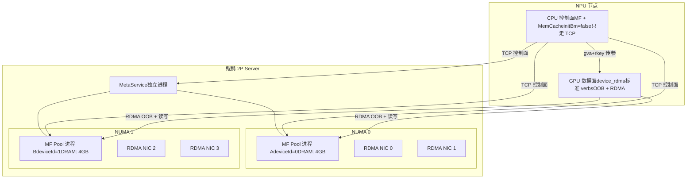
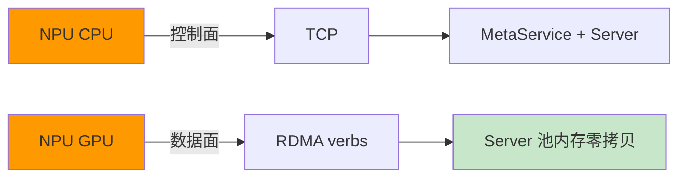
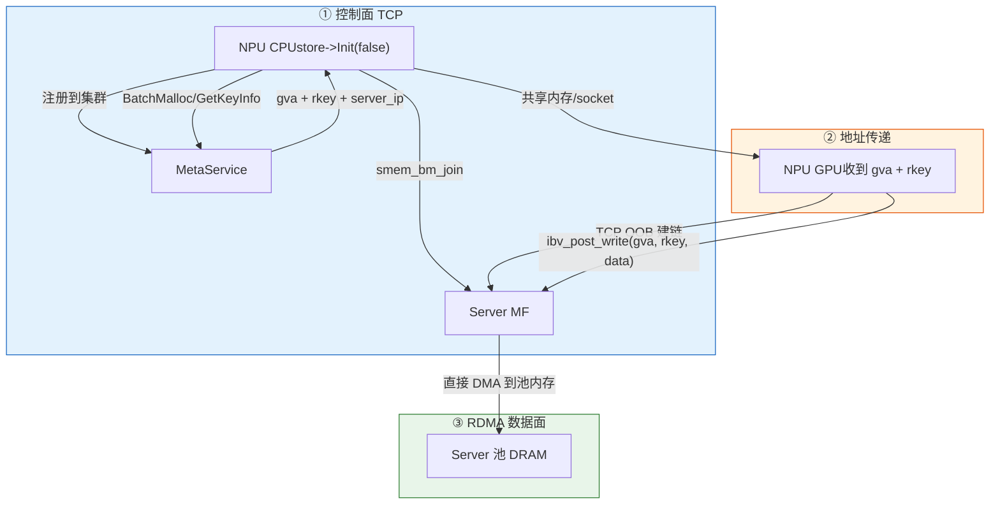
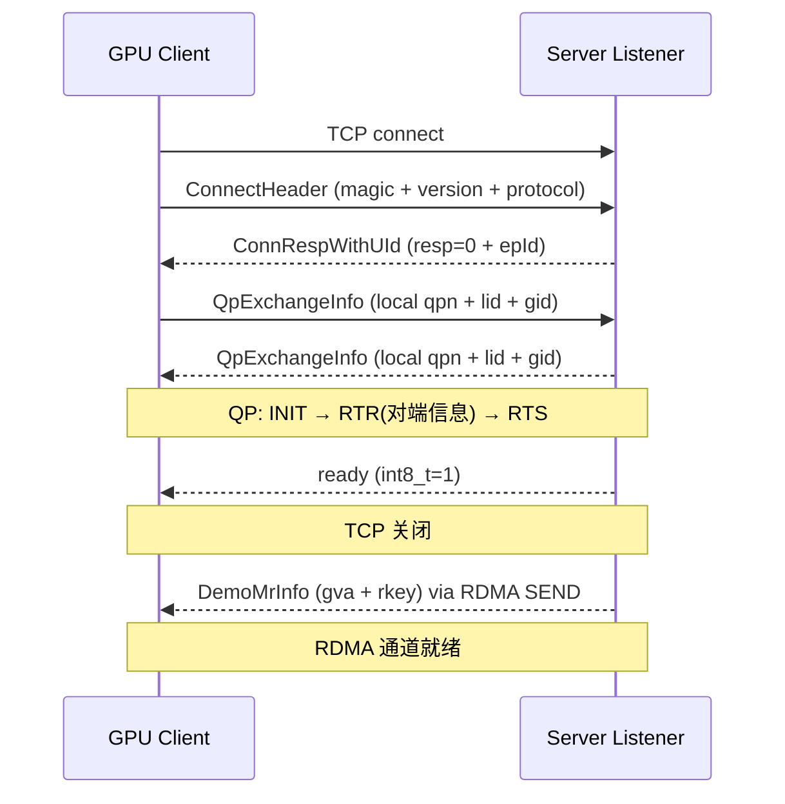

# 三方 GPU 设备通过 RDMA 直连鲲鹏服务器的 MemFabric 内存池

**作者 (Authors):** @hhy<br>
**创建日期 (Created):** 2026-07-29<br>
**更新日期 (Updated):** 2026-07-29

---

# 1. 概述

## 1.1 简介

本方案实现**三方 GPU/NPU 设备通过 RDMA 直连鲲鹏服务器的 MemFabric 内存池**，达到数据零拷贝、跨机直接访问的目标。

鲲鹏服务器（2P 架构）提供 2 个 NUMA 内存池实例，外部 GPU/NPU 节点通过标准 verbs RDMA 直连读写池内存。NPU 节点侧采用 **CPU 控制面 + GPU 数据面** 分离架构：CPU 侧处理集群控制面（TCP），GPU 侧走 RDMA 数据面（标准 verbs），实现控制通路与数据通路解耦。

## 1.2 动机

在 LLM 推理和 GR 推理场景中，KVCache 需要跨机共享。当前问题：

- **跨机数据搬运延迟高**：传统 TCP 拷贝路径经过 CPU，延迟大、带宽低
- **多 client 难以共享同一份数据**：每个 client 只能看到自己注册的 MR 地址，无法直接定位其他节点写入的数据
- **NUMA 非亲和访问损失性能**：RDMA 网卡跨 socket 访问内存导致额外延迟

本方案通过 RDMA 直连 + MF GVA 管理 + GPU/CPU 分离架构解决上述问题。

## 1.3 目标

**目标：**

- 鲲鹏 2P 服务器提供 2 个 NUMA 内存池实例，每实例绑 2 张 RDMA 网卡
- NPU 节点通过 RDMA verbs 直连池内存，零拷贝
- CPU 控制面不参与数据路径，只做 join / GVA 查询
- 多 client 多 server 共享统一 GVA 地址空间
- **全程不调数据拷贝接口**，只调控制面接口

**非目标：**

- 不实现 MemCache / MF 内部协议改造（复用现有）
- 不实现 NPU 驱动层适配（使用标准 verbs）
- 不作为通用 RDMA 存储方案（仅 KVCache 场景）

# 2. 用例分析（需求分析）

## 2.1 功能需求

| #   | 功能  | 说明  |
| --- | --- | --- |
| F1  | NUMA 亲和的内存池 | 2P 服务器提供 2 个 NUMA 实例，内存分配不跨 socket |
| F2  | 多网口暴露 | 每 NUMA 实例绑定 2 张 RDMA 网卡，client 可选就近连入 |
| F3  | GVA 统一寻址 | 多 client / server 通过全局虚拟地址访问数据 |
| F4  | CPU 控制面 | NPU 侧 CPU 进程：集群注册、GVA 查询、不碰 RDMA |
| F5  | GPU 数据面 | NPU 侧 GPU 进程：标准 verbs OOB 建链 + RDMA read/write |
| F6  | 零拷贝 | 数据从 GPU 直接写入 Server 池内存，不经过 CPU memcpy |

## 2.2 关键性能指标

| 指标  | 目标  |
| --- | --- |
| RDMA 单链路带宽 | TBD（取决于硬件规格） |
| OOB 建链时间 | TBD |
| 控制面延迟 | TBD |

## 2.3 约束

- NPU 节点必须支持标准 libibverbs（`ibv_post_read/write`）
- Server 端无 NPU，纯 CPU 节点
- 跨 socket 不访问（NUMA 隔离）

# 3. 方案设计

## 3.1 总体方案

### 3.1.1 系统拓扑



### 3.1.2 核心架构原则



**控制面和数据面严格分离：**

| 层面  | 运行位置 | 协议  | 涉及组件 |
| --- | --- | --- | --- |
| 控制面 | NPU CPU | TCP | MF + MemCache |
| 数据面 | NPU GPU | RDMA verbs | device_rdma |

CPU 控制面做的事：

1. 通过 TCP 连 MetaService 注册到集群
2. 通过 TCP 连 Server MF 做 `smem_bm_join`
3. 查询 GVA（`BatchMalloc / GetKeyInfo`）
4. 把 gva + rkey + server_ip 传给 GPU

GPU 数据面做的事：

1. 拿到 gva + rkey 后 TCP OOB 建链
2. `ibv_post_write(gva, rkey, data)` 写数据
3. `ibv_post_read(gva, rkey, buf, len)` 读数据

### 3.1.3 数据流



## 3.2 技术选型

| 方案  | 优点  | 缺点  | 决策  |
| --- | --- | --- | --- |
| 全走 MF HCOM 传输层 | 无需额外开发 | 协议不对外暴露，GPU 侧难适配 | ❌   |
| **CPU 控制面 + GPU 裸 verbs** | 控制数据分离，GPU 只需标准 verbs | 需写轻量 server listener | ✅   |
| 全走 TCP 数据面 | 无需 RDMA 硬件 | 性能差，CPU 参与数据拷贝 | ❌   |
| GPU 也跑完整 MF | 统一技术栈 | GPU 侧 MF 依赖重，部署复杂 | ❌   |

## 3.3 功能与性能设计

### 3.3.1 Server 端流程

每 NUMA 实例运行一个 Server 进程：

```cpp
// server_process.cpp — 鲲鹏侧
#include "mmcache.h"
using namespace ock::mmc;

int main(int argc, char *argv[]) {
    // 1. 解析参数
    uint32_t deviceId = std::stoi(argv[1]);     // 0 或 1
    std::string metaUrl = argv[2];
    std::string hcomUrl = argv[3];
    uint64_t dramSize = std::stoull(argv[4]);

    // 2. MemCache 初始化（内部调 MF）
    auto store = ObjectStore::CreateObjectStore();
    local_config config = create_default_local_config();
    config.meta_service_url = metaUrl;
    config.protocol = "host_rdma";
    config.hcom_url = hcomUrl;
    config.dram_size = dramSize;
    config.world_size = 8;
    store->Setup(config);
    store->Init(deviceId, true);    // 提供内存

    // 3. 暴露池内存给 GPU client（自定义 OOB 建链）
    //    用 smem_bm_ptr_by_mem_type 拿 gva
    //    开 TCP listener 等 GPU 连入
    //    OOB 建链后发 gva + rkey
    //    保持运行
    pause();
}
```

### 3.3.2 NPU CPU 侧流程

```cpp
// npu_cpu.cpp — NPU 节点 CPU 侧
#include "mmcache.h"
using namespace ock::mmc;

int main() {
    // pure client 模式，不提供内存，只做控制面
    auto store = ObjectStore::CreateObjectStore();
    local_config config = create_default_local_config();
    config.meta_service_url = "tcp://192.168.0.1:5124";
    config.protocol = "host_tcp";       // 只走 TCP，不涉及 RDMA
    config.world_size = 8;
    store->Setup(config);
    store->Init(0, false);              // pure client

    while (true) {
        // 接收应用层请求
        auto req = GetRequest();

        // 查询 GVA
        auto gvas = store->BatchMalloc({req.key}, {req.size}, MEDIA_DRAM);
        // 或
        auto info = store->BatchGetKeyInfo({req.key});
        // info[0].gva_  → GVA 地址
        // info[0].loc_  → 所在 server

        // 把地址传给 GPU
        SendToGpu(info[0].gva_, info[0].loc_);
    }
}
```

### 3.3.3 GPU 侧流程

```cpp
// gpu_data.cpp — NPU 节点 GPU 侧（已有 device_rdma 代码）
// 建链协议：
//   TCP connect(server_ip, port)
//   → ConnectHeader (16B)
//   ← ConnRespWithUId (10B)
//   → QpExchangeInfo (60B)
//   ← QpExchangeInfo (60B)
//   QP: INIT → RTR → RTS
//   ← ready (1B)
//   TCP 关闭，RDMA 通道就绪

// 数据读写：
ibv_post_write(gva, rkey, data_buf, len);   // 写数据到池
ibv_post_read(gva, rkey, read_buf, len);     // 从池读数据
```

### 3.3.4 建链协议



| 字段  | 大小  | 说明  |
| --- | --- | --- |
| `ConnectHeader` | 16B | magic(0x100) + version + protocol |
| `ConnRespWithUId` | 10B | connResp(2B) + epId(8B) |
| `QpExchangeInfo` | 60B | lid + qpn + gid + wr 配置 |
| `DemoMrInfo` | 24B | addr(8B) + rkey(8B) + size(8B) |

## 3.4 安全隐私与DFX设计

### 可测试性

- **device_rdma 独立验证**：可在无 MF 的单机上用 SoftRoCE 测试 RDMA 建链和数据读写
- **分阶段验证**：先验证 RDMA 通路，再验证 MF 池集成，再端到端

### 可靠性

- MetaService 提供 HA 模式
- MF 内置连接心跳和重连机制

## 3.5 编程与调用设计

### 3.5.1 开发环境

| 组件  | 环境  |
| --- | --- |
| Server 编译 | aarch64 Linux, GCC ≥ 11.4, CMake ≥ 3.12 |
| GPU 编译 | NPU 侧, 需 libibverbs-dev + 对应 GPU SDK |
| 依赖库 | libmf_smem.so, libmemcache_hybrid.so, libibverbs |

### 3.5.2 接口定义

#### Server 启动接口

```bash
./server_process --device-id <0|1> \
    --meta-service-url tcp://<ip>:<port> \
    --protocol host_rdma \
    --dram-size <size> \
    --hcom-url <ip:port[,ip:port]>
```

#### NPU CPU 控制面接口

```cpp
// MemCache ObjectStore API
store->Setup(config);
store->Init(deviceId, false);           // pure client
store->BatchMalloc(keys, sizes, media); // 返回 GVA
store->BatchGetKeyInfo(keys);           // 查询 GVA + loc
```

#### GPU 数据面接口

```cpp
// 标准 verbs，无 MF 依赖
ibv_post_write(gva, rkey, buf, len);
ibv_post_read(gva, rkey, buf, len);
ibv_post_send(qp, buf, len);            // SEND
ibv_poll_cq(cq, 1, &wc);               // 轮询完成
```

# 4. 缺点和风险

| 风险  | 影响  | 应对措施 |
| --- | --- | --- |
| GPU 侧 OOB 协议和 Server 端 listener 协议不对齐 | 建链失败 | 使用定义的固定协议结构，两端独立实现 |
| 多 client 并发时 Server 端 listener 瓶颈 | 建链超时 | 每 NIC 独立 listener 线程，或使用线程池 |
| MF/MemCache 版本升级导致 API 不兼容 | 编译失败 | 锁定版本号，构建时验证 |

# 5. 现有技术

- **MemFabric** (memfabric_hybrid)：提供 `libmf_smem.so`，实现 GVA 管理和 RDMA 传输
- **MemCache** (memcache_hybrid)：提供 `ObjectStore` KV 接口，封装 MF
- **SoftRoCE**：无 RDMA 硬件时可用软件模拟验证
